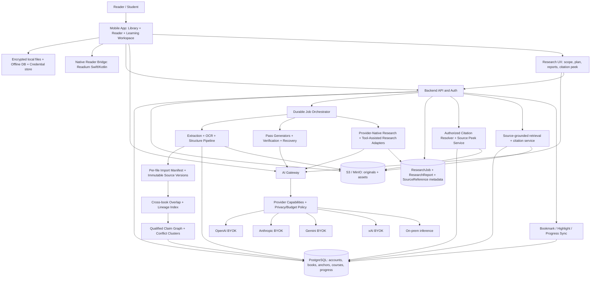

# AI-Guided Reading & Adaptive Learning Platform

**Codex implementation specification / product requirements / reference architecture**  
**Version:** 1.3 · **Prepared:** 2026-11-03 · **Status:** Implementation blueprint (v1.2 + in-session BYOK/on-prem model hot-switching and inference catalog discovery)  
**Targets:** iOS + iPadOS + Android phones/tablets; backend deployable in cloud or on-premises  
**Working product name:** *Learning Edition* (renameable; do not hard-code brand identity)

> **Agent instruction:** Build an actual, maintainable reader and learning system—not a chat interface that merely summarizes books. Preserve the source publication and its exact locations. Deliver functionality incrementally, with tests and meaningful vertical slices. Do not pretend that an unsupported file format, provider feature, persistent job, or model capability is implemented. Use this specification as the source of truth; record unresolved design decisions in ADRs before implementing irreversible choices.

## 0. Product vision, assumptions, and non-negotiables

The app combines Kindle-quality reading, highlights and notes, bookshelf management, **multi-book batch upload and source-aware evidence reconciliation**, **provider-backed Deep Search**, **inline source-page previews and cross-book navigation**, source-anchored research, a contextual AI assistant with **in-session model switching across BYOK and llm-inference-engine**, interactive lessons, three-pass adaptive learning, section-end checkpoints, formal multiple-choice assessments, and targeted recovery instruction.

**North-star outcome:** A reader can import a book, enjoy reading its original content, explore concepts in place, transform it into a verifiable multi-pass guided course, move freely between learning depth levels, assess understanding, recover specific knowledge gaps, and resume exactly where they stopped.

**Distinct product modes:**

1. **Read:** Original publication, with search, navigation, annotations, bookmarks, dictionaries and optional AI explanations. Works without an API key or an AI-generated course.
2. **Learn:** Versioned, AI-generated learning edition linked bidirectionally to the original. Pass 1 (conceptual), Pass 2 (technical), Pass 3 (assessment) plus recovery; interactive diagrams and experiments where appropriate.
3. **Review:** Highlights, notes, open questions, diagnostic gaps, optional flashcards, spaced review, and concept mastery.

**Non-negotiable boundaries:**

- The user always retains access to the original publication; a learning edition is an *overlay*, not a destructive replacement.
- **One user can own many books**, with zero or more shelves per book, per-book settings, multiple reading cursors and independent course progress.
- **A user can import several books in one upload session**; every file has independent validation, processing status, rights, provenance and retryability. A failure in one file must not corrupt other imports.
- **Do not silently blend sources.** A multi-book answer/lesson must preserve what each author/edition actually says. Agreement, contradiction, context mismatch, shared citations and duplicated/derivative text are distinct relationships—not interchangeable evidence.
- **Source repetition is not independent corroboration.** Quote overlap, common upstream sources, translations, abridgments and editions must be represented explicitly; deduplication of storage or retrieval results must never erase source identity or navigable citations.
- A research or learning job has an immutable, explicit **source-scope snapshot**, including selected book/source-version IDs and per-book egress/rights settings. Default in-book chat scope remains the current book; never expand to an entire shelf/library just because its books are indexed.
- **Reading completion, learning-pass coverage, and assessed mastery are separate metrics.** Never manufacture a single opaque percentage.
- **Passes are freely navigable.** The user may jump to Pass 2 or Pass 3 at any section without prerequisites; the app may recommend a route but must not enforce it.
- **Checkpoints always appear at the end of each book section.** They are informal, ungraded reflection/interaction surfaces and **not** Pass 3. They may feed adaptive assessment or recovery.
- Quote-based questions and cross-chapter detours must preserve the current **book + section + concept + pass + anchor + task state** in a return bookmark stack.
- Every source-derived claim, quotation, table, diagram and learning card should point to an identifiable location in the uploaded book. The app must label external additions and model interpretations separately. **Book references and source citations must support a safe preview and an authorized Open source action.**
- Mobile has no dependable hover. **Long press + selection handles** is the primary text selection interaction; hover is supported only where a pointer exists (tablet/desktop-like environments).
- The **default inference setup is BYOK** for OpenAI, Anthropic Claude, Google Gemini and xAI Grok. An on-premises/self-hosted inference endpoint is an additional selectable provider, not a mandatory dependency. **Deep Search must route only to provider-supported research APIs/tools as discovered, distinguishing native/delegated research from application-orchestrated tool-using search; never fabricate native provider support.**
- **HOT-SWITCH NON-NEGOTIABLE:** Within *any* reading or learning session, the reader can switch the selected AI assistant model at any time among (a) models for which the reader has an operational, authorized BYOK connection and (b) open-weight/open-source models currently advertised and permitted by the `llm-inference-engine` catalog. The selected model is always visible in the assistant UI, including phone and tablet layouts. Model switching must preserve reading/curriculum cursor, source selection, detours, annotations and existing chat history; it must never silently transfer an in-flight generation or durable job to another provider or relax book-level egress policies. See §1.7, §3.11 and §6.6.
- No API key is required to import, read, bookmark, highlight, annotate, search existing indexed text locally or export the user's annotations. AI features must show a useful setup message rather than fail silently.
- Do not bypass DRM, paywalls, copyright access controls or third-party restrictions. Source upload does not imply rights to redistribute a book or generated derivative content.
- Never treat text inside uploaded books, PDFs, retrieved pages or tool responses as trusted instructions. These are **data**, even if they contain apparent system prompts. **Research tool use, external network access and cross-book queries require explicit user-policy authorization and cost/egress boundaries.**
- Never run model-generated HTML/JavaScript/code with unrestricted mobile privileges. Interactive visualizations are rendered from safe, typed application-owned components or isolated sandboxes.

### 0.0.1 Version 1.1 amendment / change log

- `RESEARCH-001..008`: **Deep Search** in the in-book AI assistant, initiated from a selected quote, current section/chapter, whole book or explicitly opted-in library scope; provider-native research where available; clear fallback labels, preflight plan, explicit egress and budget consent, durable job state, traceable citations and saveable research reports.
- `CITE-001..008`: **Source link previews and book-of-interest navigation**: desktop/tablet pointer hover or focus, mobile tap/long press, authorized PDF page or EPUB section peek, figure/math focus, in-library cross-book navigation, and bibliographic / licensed official-preview handling for not-owned books.
- Amended provider capability registry, UI actions, source provenance, data contracts, API routes, threat model, integration tests, acceptance criteria, phases, ADRs and repository layout. Existing three-pass and section-end-checkpoint rules remain unchanged.


### 0.0.2 Version 1.2 amendment / change log

- `BATCH-001..007`: Multi-file import in one picker/share session with a batch manifest, per-file checksums/edition matching, resumable jobs, duplicate suggestions, partial completion, isolated failures and explicit multi-book comparison scope.
- `PROV-001..008`: Immutable book/edition anchors; quote and passage overlap detection; bibliographic and upstream-source lineage; independent-vs-dependent evidence; edition-aware source previews; source-scope snapshots; citations that never lose their original attribution.
- `CONFLICT-001..010`: Atomic, qualifier-rich claim extraction; cross-book alignment; contradiction/entailment/context-mismatch classification; uncertainty/abstention; evidence graphs and user-reviewable conflict clusters; side-by-side compare UI; safe generation and assessment semantics.
- Amended assistant retrieval, Deep Search, course conversion, data entities, OpenAPI routes, trust/privacy, evaluation gates, CI tests, repository layout, and release phases. Earlier requirements remain in force.


### 0.0.3 Version 1.3 amendment / change log

- `SWITCH-001..012`: **Anytime in-session model switching** for the in-book assistant across valid BYOK proprietary models and all authorized models listed by the reader's `llm-inference-engine`. The picker is available in the assistant header without leaving the reading context, with provider, model, capability, reachability, privacy and effort metadata.
- Introduce **catalog federation, truthful live readiness, provider-specific effort mapping, per-thread/turn model selection, explicit streaming interruption and retry semantics, task-pinned long-running jobs, continuity/context-budget rules, provenance/cost accounting, and source-privacy enforcement**.
- Add `ModelCatalogEntry`, `SessionModelSelection`, `InferenceAttempt`, `ModelSwitchEvent` contracts; gateway routes, privacy gates, UI states, E2E tests and Phase C acceptance criteria. No previously implemented feature is removed. The library settings route remains the place to *configure* providers; the reader panel is the place to *choose* between ready models.


### 0.1 Target personas and core journeys

- **Everyday reader:** Shelf → book → resume → long-press term → dictionary → highlight/note → bookmark → continue, optionally offline.
- **Graduate/student:** Upload PDF → preview original TOC/figures → Convert to Guided Learning → Pass 1 → experiment → section checkpoint → Pass 2 → math/code → Pass 3 quiz → targeted recovery → reassessment.
- **Engineer/researcher:** Select formula in scanned/technical PDF → Ask AI or **Deep Search** with figure and source context → inspect cited original page in preview → compare other books/papers → follow a cross-chapter detour → return to exact equation and pass.
- **Privacy-conscious reader:** Import locally, no cloud LLM egress; optionally connect a reachable HTTPS on-prem inference endpoint; review data-egress settings before converting.
- **Multi-book learner:** Organize library shelves, cross-reference concepts, find notes across books, **peek a cited page in another owned book or open a catalog card for a book not owned**, keep separate progress and source citations.
- **Batch-import academic reader:** Select 3–20 books in one session, review duplicates/editions, import with independent progress, choose a subset for evidence comparison, inspect author disagreements and overlapping citations, and resume the original books separately.

### 0.2 Priority vocabulary

- **P0 / MVP:** Required for the first usable end-to-end product.
- **P1 / V1:** Required for a mature user-facing release after a working MVP.
- **P2 / Later:** Valuable but not a blocker for the first release.
- **Stretch / research:** Must be evaluated before committing to scope.

## 1. Navigation architecture and UX contract

### 1.1 Top-level navigation

Suggested bottom tabs on phone: **Library · Continue · Review · Profile**. The in-reader experience is a dedicated immersive screen reached from Library/Continue. **Settings and AI Providers must be reachable from the Library screen** via a visible gear/profile action; do not bury BYOK setup inside an unrelated flow. On tablet, use persistent sidebar navigation when space allows.

**Library:** Covers, authors, formats, import status, read %, learned section %, mastery %, last opened, size, shelf membership, tags, smart filters, search, quick resume, upload and conversion actions. Shelf tiles with counts, manual drag/drop or multi-select organization. A book can belong to multiple shelves. Empty states are useful, not blank.

**Continue:** Resume cards for recently opened books and incomplete courses; restore exact source location, pass, interactive experiment state, pending question or detour, not just last chapter.

**Review:** All highlights, annotations, saved quotes, flagged sections, pending quizzes, weak concepts, recovered concepts, optional study cards and spaced-repetition queue. Filters by book/shelf/tag/date/concept.

**Profile/Settings:** Identity, cloud sync, privacy and processing permissions, BYOK provider vault, model/effort settings, on-prem endpoint, data export/deletion, accessibility, language, themes, consumption/budget records.

### 1.2 Reader screen: devices and adaptive layout

**Phone portrait:** Original content occupies most of the screen. Minimal chrome; tap to toggle controls. Top bar: back, book title/chapter, TOC and search. Bottom or floating rail: Read/Learn toggle, highlight list, bookmark, Ask AI. Selection opens a native-feeling anchored action toolbar with **Deep Search**. AI assistant uses a **resizable bottom sheet** (compact peek → half height → full screen), or switches to a separate screen preserving the selection and reading cursor. **Citations open a lightweight source peek sheet first; an explicit Open source command navigates.** The reader must not become narrower than its comfortable minimum width.

**Phone landscape:** Prefer full reader with an optional AI overlay or split when accessibility font size and available width permit.

**Tablet landscape/large tablet:** Left optional collapsible table-of-contents/shelf sidebar; center reading/lesson pane; **right-hand assistant panel** at responsive width; adjustable divider if practical. Both panels preserve independent scroll and scroll restoration. Right assistant panel can be opened with no text selection. **Citation hover/focus shows an anchored page/section popover without replacing the assistant; Open source navigates a reader pane with Back to research.**

**Pointer/stylus devices:** Support hover preview for source citations and book references, selection, keyboard shortcuts, and secondary-click context menu. Keyboard focus/Enter/Space must offer the same preview actions. Never make hover necessary for a task.

**Reading display:** Original PDF page fidelity with pinch zoom; EPUB reflow where supported; line spacing, margins, font family/size, light/dark/sepia themes, paginated vs continuous scrolling, RTL scripts and CJK selection, dynamic type, reduced motion, and VoiceOver/TalkBack. Allow user to choose original-layout or accessible text view only where the conversion is trustworthy; don't falsely promise reflow for every PDF.

### 1.3 In-reader learning workspace: TWO INDEPENDENT NAVIGATION AXES

Axis A: **Book chapter → section → subsection → concept → anchored figure/equation/selection**.  
Axis B: **Pass 1 | Pass 2 | Pass 3**, freely switchable, with optional **Recovery** mode/context.

Recommended header:

```text
┌─────────────────────────────────────────────────────────┐
│ ‹ Library   Book / Ch. 1 / §1.2.3       TOC  ☰  AI ›     │
│ [Pass 1: Concepts] [Pass 2: Technical] [Pass 3: Quiz]    │
│ Section: WordPiece & Unigram LM    source p.53  [Open ↗] │
├─────────────────────────────────────────────────────────┤
│ Source-linked lesson + diagram / experiment             │
│                                                         │
│ [Quote/highlight/add note/ask/see original]              │
│                                                         │
│ ...content ...                                           │
│                                                         │
│ ▼ Section-end checkpoint (UNSCORED; all passes)          │
│   Clear / Uncertain / Explore deeper / Leave question    │
│ [Next section] [Previous] [Jump to source]              │
└─────────────────────────────────────────────────────────┘
Tablet: assistant opens in a right-hand panel; on phones, a sheet.
```

**Cross-pass anchor matching:** Selecting Pass 2 while reading the WordPiece explanation in Pass 1 navigates to the *same concept*, not the beginning of Pass 2. If no exact matching anchor exists, use the closest relevant section and show a small 'No exact counterpart' indicator; do not silently move to an unrelated concept. Same rule for Pass 3: open the assessment filtered to the current concept/section with an option to start the full module assessment.

**Persistent breadcrumbs:** Book name → section → concept → Pass; tap to jump. Explicit 'Return to source', 'Return to detour origin', and 'Resume main path' actions.

**Reading vs learning mode:** Original Reading and Guided Learning use the same publication identity but separate cursors. Switching modes should restore the most recent location in the destination mode; offer 'Open corresponding source position' when meaningful.

### 1.4 Section-end checkpoints (distinct from Pass 3)

Each section in each learning pass (and optionally in Read mode) has an independently addressable **end-of-section checkpoint**. Required controls:

- 'I understand' / 'I'm uncertain' / 'Explore deeper' / 'Save a question'.
- Optional short, open-ended reflection, **not** automatically scored like Pass 3.
- Quote-and-ask; supports references to future or previous chapters. A detour pushes the current cursor on a navigation stack.
- 'Resume from where I stopped' restores scroll/anchor/experiment state/selection after detour resolution.
- Checkpoint responses become **weak diagnostic signals** for Pass 3 item selection, not proof of mastery and not an automatic grade.
- User can skip, revisit or edit any checkpoint, with provenance/timestamps; do not block advancement.
- Display 'covered', 'needs clarification', 'deep dive pending', 'questions resolved' separately.

### 1.5 Pass 3 assessments

Pass 3 is a **formally graded, independently navigable** question workflow. It may cover a current section, a whole chapter, a coherent group of sections, or a selected concept. It is never the same UI/state object as an informal checkpoint. Detailed algorithmic rules in §5.

### 1.6 Important states to design deliberately

Loading, no-books, no-file-permission, unsupported/encrypted file, offline, no BYOK key, expired/invalid key, missing model capability, conversion in progress/paused/partial/error, ambiguous source anchor, low-confidence OCR, missing figure, model timeout, **selected model removed/offline, engine catalog stale, invalid current model, unsupported effort after switching, stream cancelled before model retry, model-selection revision conflict**, budget exceeded, interrupted quiz, annotation sync conflict, insufficient permissions, user-deleted source. Every state requires an accessible explanation and a recovery action.

### 1.7 In-session model picker and effort controls [P0; anytime switching]

**Mandatory placement:** Show `Model: [Provider / Model ▾]` and `Effort: [Supported value ▾]` in the assistant header whenever the assistant is opened, whether a quote is selected or not. Never require leaving the book or returning to Library Settings to switch. Phone: sticky compact header in assistant sheet/full-screen; tablet: persistent right-panel header. The model picker remains usable while reading, during an assistant stream, after network recovery, and from a detour. Also expose an `AI model` quick action in the reader toolbar, so a reader can choose before opening a chat.

```text
Book §1.3.6  [Pass 1]                         [Ask AI]
┌─ Assistant · current book / selected quote ────────────────┐
│ Model: [On-prem / qwen-available-model ▾]  Effort: [Auto ▾] │
│ [Current section · Source grounded] [Deep Search]          │
│                                                             │
│ Assistant conversation (per-message model attribution)     │
│ ...                                                         │
│ [Message...]                              [Send] [Stop]      │
└─────────────────────────────────────────────────────────────┘

Model picker:
[Search models...] [All | BYOK cloud | On-prem] [Capable for this task]
• OpenAI    account-connected model  Ready · text · vision · effort…
• Anthropic account-connected model  Ready · text · effort…
• Gemini    account-connected model  Ready · …
• xAI       account-connected model  Ready · …
• Local     discovered engine model  Ready / Loading / Offline · …
```

- **Catalog meaning:** Present all discovered models as candidates, but selectable models must be authorized, configured, reachable and compatible with the current task. Unavailable/incompatible entries remain discoverable with a clear disabled reason; do not imply any proprietary account/key guarantees access to every provider model. Never show sample model names as a live list.
- **User choice hierarchy:** Explicit per-turn override (if UI supports it) > currently selected thread model > optional book-specific assistant preference > Library default. Changing the active thread selection updates **future turns**, not historical responses or long-running tasks. Persist the selection across app restarts and detour navigation.
- **Effort:** Show only verified, model-appropriate effort controls; offer `Auto / Not available` if unsupported. Preserve the user's *intent* when moving providers (e.g. Fast/Balanced/Deep) only if mapped to a real supported provider value; reveal the exact effective setting, never fabricate cross-vendor equivalence.
- **Before switching:** When moving from local/on-prem to cloud, or to a provider not yet approved for the current book(s), show the exact source-scope/excerpt/figure manifest and obtain required egress and cost consent. A denied switch may select the model for other permitted tasks but cannot send that restricted content. No automatic cloud fallback.
- **In-flight policy:** Changing the picker while a response is streaming changes the **next-turn default**; the running response stays pinned to its originating model. Offer `Stop current response and retry with [new model]` as an explicit separate action. Stop/cancel upstream where supported; preserve partial text as *interrupted*, not as a finished answer; retry as a new `InferenceAttempt` with new authorization/cost checks.
- **Long-running operations:** Deep Search, course conversion, source conflict analysis, and assessment-generation jobs retain the provider/model/capability/scope/budget snapshot taken at submission. A new assistant model does not mutate them. Provide `Cancel + duplicate/restart with new model` after the user reviews cost and provenance; never transfer an opaque provider job to a different vendor.
- **Comparisons [P1]:** Allow deliberate `Ask same question with another model`/side-by-side responses with independent citations, latency and cost labels. Never blend outputs into an apparent single sourced answer.
- **Accessibility:** 44x44pt-equivalent touch targets, VoiceOver/TalkBack labels, hardware keyboard access, focus restoration, screen-reader announcement of active model and status, usable one-handed sheet; model selection must not shift the reading cursor or lose selected text.


## 2. Library and reading features

### 2.1 Books, shelves and library [P0]

- Multiple books per reader; book metadata (title, author, publication date if present, cover, language, file type, file size, edition, tags, date imported, source checksum).
- Create, rename, reorder, archive and delete shelves; multiple shelf memberships; optional smart shelves ('Reading', 'Finished', 'Awaiting Conversion', 'Needs Review', etc.).
- Search across title, author, tags and notes; sort by recently opened, progress, title, author, imported, last annotation; filters by format, status and shelf.
- Book detail: synopsis if present, original TOC, file details, privacy location, conversion status, original/learning progress, bookmarks/highlights counts, models used, cost estimate if generated, 'Read', 'Learn', 'Convert to Guided Learning'.
- **Three separate progress values**: `reading_progress` based on original document location/estimated positions; `course_coverage` per pass and section; `mastery_score` from validated assessments. Show denominators and estimated-vs-exact status, no false precision.
- Detect duplicate uploads by hash; give user choices (reference existing, import alternate edition, replace file while retaining annotations only if anchor migration verified). Maintain versions; never silently overwrite annotations.
- **P0 batch upload:** Multi-select files from platform picker, tablet drag/drop, or multiple share-sheet items. Display a *batch queue* and per-file states; show candidates for exact duplicate, edition/reprint, translation and near-duplicate separately. Allow per-file cancel/retry/remove without canceling the rest.
- **P1 evidence overview:** For any explicitly selected books/shelf, show independent source count, shared passages/references, potential contradictions, unresolved cases and last-indexed coverage; do not treat these counters as a truth score.
- Per-book dedicated search and annotation index; cross-book search is optional P1.

### 2.2 Core reading [P0]

- EPUB 2/3 and PDF with internal TOC, chapter navigation, page/location jump, bookmarks, search, back/forward navigation history, progress autosave, first/last read timestamps.
- Accurate original PDF pages/figures/equations/tables; PDF zoom, fit width/page, continuous and page turn modes. EPUB reflow and fixed layout if supported.
- 'Read original' jump from every AI-generated content item; return to lesson without losing its cursor.
- Navigation by next/previous section, TOC, go to page/position, search result, highlight/bookmark; restore scroll and zoom.
- Per-book reading options: font/margins/spacing (where format supports), theme, brightness (where available), scroll/pagination, reading direction, text size.
- Offline original file availability and local bookmarks/notes by default once imported/downloaded. No AI key required.

### 2.3 Selection toolbar: word, phrase, sentence, multi-paragraph [P0]

On phone, long press to select a word, drag handles to span ranges; on tablet, pointer hover may preview the toolbar but should not capture selection until activation. **Actions**:

1. **Dictionary**: show definitions, pronunciation where licensed, senses and part of speech; explain unavailable languages; distinguish dictionary content from AI-generated definitions. Use platform dictionary or legitimately licensed content; never scrape commercial dictionaries.
2. **Search Google**: construct a URL-encoded query and open Google Search in OS browser/custom tab, or use a properly licensed search API. Clearly signal that selected text leaves the app; do not scrape Google results.
3. **Explain with AI**: open assistant with the selected exact quote + surrounding paragraph + section + page/locator and focus the response on that selection. Optional commands: simplify, deepen, example, derive, compare, translate, find in book. **Deep Search**: start a source-grounded external/multi-step research workflow scoped to the selection or explicitly enlarged chapter/book/library context; show research plan and egress/cost permissions before starting.
4. **Highlight**: color palette, tags, edit/delete, note and pin. Distinguish user mark from model-generated highlights.
5. **Add note**: text/Markdown note attached to the exact selection; optional link to other books/concepts.
6. **Bookmark/flag**: current page, section, concept or selected text; optional label and reason.
7. **Copy / share quote**: respect user privacy, source attribution, and relevant rights/quoting limitations; add source citation metadata to exports.
8. **Translate** [P1]: show source/target language and provider selection; remember reader preference; user may disable network translation.
9. **Generate flashcard** [P2]: create user-editable prompt/answer grounded in the selection.

Toolbar supports dark mode, screen readers, large touch targets, and scroll/zoom without accidental selection dismissal.

### 2.4 Highlights, notes and anchors [P0]

- Highlights and annotations must be stored as **source-located entities**, not only as free text or screen coordinates.
- Use a robust locator: Readium locator/EPUB CFI where appropriate; PDF page index + page-space quadrilaterals/rectangles for display and selection; content-version hash; normalized quote + prefix/suffix (W3C TextQuoteSelector); character offsets when available; section ID and optional OCR confidence.
- Support cross-page PDF selections and EPUB reflow/font changes; highlight persists and navigates correctly after app restart.
- When a source file changes, re-anchor by exact quote and contextual disambiguation, with a confidence threshold. Show 'Needs re-anchoring' rather than silently attach to a wrong passage.
- Notes contain user-authored body, creation/update timestamps, optional color/tags, source quote/locator, note history. Export per book/shelf/all as Markdown/JSON/CSV (PDF highlight export later). Original source retains priority.
- Readwise-style single 'Highlights & Notes' view with jump-to-text and filters; full-text search notes and annotations. <https://docs.readwise.io/reader/docs>
- Support a named bookmark even where no text is selected; keep most-recent reading cursor separate from manually saved bookmarks.

### 2.5 Reader-app best practices beyond the requested features

**P1:** Search within book including exact and fuzzy phrases, reading goals without manipulative streak pressure, smart collections, recent highlights, share sheet import, file/folder import, EPUB accessibility controls, text-to-speech with playback speed and synced read position, glossary of recurring terms, export/import annotations, cross-device sync and offline queue, multilingual dictionary/translation, highlight resurfacing and 'jump back to original', review history, text selection over mathematical notation with image crop fallback.

**P2:** Spaced-repetition study cards (SM-2/FSRS-type scheduler, versioned and validated), concept graph across books, reading insights/heatmaps with opt-out, collaborative study groups, citations in research-note format, link highlights to external notes tools via explicit integrations, pronunciation, semantic cross-book search, author/edition comparison, multimedia audio-book and comics support, browser/web companion, external keyboard/stylus commands.

**Not default:** Social public sharing of copyrighted uploads, intrusive notifications, artificially inflated reading streaks, unlicensed third-party store/catalog integrations, DRM circumvention, or paid-book redistribution.

These interaction patterns are consistent with Apple Books' word selection, highlights, notes and translation/search workflows, and Readwise Reader's unified reading/highlight/review approach: <https://support.apple.com/en-ae/guide/iphone/iph17bf340c/ios> and <https://docs.readwise.io/reader/docs>.

### 2.6 Source citation previews, page peek and cross-book navigation [P1; internal source links P0]

**Core requirement:** A cited `Figure 1.3`, `p. 61`, quoted statement, local book title, research report bibliography entry or generated lesson `Source` chip behaves as a navigable **source reference**, not inert text. Distinguish **Peek** (temporary preview preserving context) from **Open** (navigational action). Source links can originate in the reader, lesson, notes, assistant, Deep Search reports, concept map, assessment explanation or bibliography.

**Interaction contract by device:**

- **Desktop/tablet with pointer:** on hover (with modest debounce) or keyboard focus, display a nonblocking popover with source title/edition, author, chapter, printed page vs PDF page index, thumbnail/short scoped excerpt and action buttons `Open in book`, `Pin preview`, `Copy citation`. It closes on pointer leave after a grace period; user may move pointer into the preview without closing it. Keyboard support is mandatory.
- **Touch phone:** single tap on citation opens a compact **page-peek bottom sheet**; long press can expose `Preview · Open · Save · Copy citation` actions. A second explicit `Open in book` action navigates to reader and highlights the cited span. Never depend on hover on touch devices or hijack normal text selection.
- **Tablet split view:** optionally display citation preview beside AI conversation; offer pinned preview + side-by-side compare without collapsing chat; avoid covering the selected formula or source paragraph.
- **Within the current owned book:** resolve `SourceAnchor` against the immutable `BookSourceVersion`; render the relevant page region (PDF page tile or crop around anchor), EPUB fragment (reflowable text using source locator), figure or equation plus a small amount of surrounding context. Clearly show the figure/table caption if available. `Open` moves the reader to the *precise original page and span*; `Back to lesson/research` restores the exact cursor and scroll state.
- **Another book already in the user's Library:** citation preview shows correct **book cover/title/author/edition + cited page/section**, not a page from a similarly named but different edition; `Open in Library` navigates to that book's source anchor and pushes a cross-book return anchor. Preserve the current course pass, assessment draft, and research report location.
- **Book not owned by the user:** show a **bibliographic card** (title, author, edition/ISBN/DOI if known, publication link, matched search snippet, public preview status); `Find in my Library`, `View authorized preview`, `Open publisher/library listing`, or `Import my copy`. **Do not render copyrighted pages unless a licensed public preview exists**. No known exact page => label `Page location unavailable` rather than manufacture a page. Never claim that a bibliographic record grants access to full text.
- **Other external sources:** cite canonical HTTPS URL/DOI/arXiv/publisher link; optionally fetch safe metadata/text summary when user allows it. For legally accessible open-access papers/PDFs, optionally fetch through a safe, permissioned document resolver and render an ephemeral cited-page thumbnail **only after verifying the document identity, page locator and applicable access conditions**; do not assume arbitrary URL search results confer preview rights. For closed/purchased sources, use provider-supplied embeddable or otherwise authorized previews only. URL snippets are **not** equivalent to verified PDF-page access.

**Recommended UI fragments:**

```text
Tablet / desktop — AI side panel                     Phone — reference peek
┌─ AI · Ask | Deep Search ────────────────┐           ┌─ Reading content ────────────┐
│ Research scope: §1.3.6 · GQA            │           │ The author cites [Book p.61] │
│ Claim... [Book p. 61] [Paper DOI]       │           └────────────────────────────┘
│          ┌─ Source preview ──────────┐ │           ┌─ Peek: Book · p.61 ──────────┐
│ (hover)  │ Figure / page crop        │ │           │ [licensed page crop/quote]  │
│          │ exact edition and label   │ │           │ Open in book · Save · Close  │
│          │ Open · Pin · Copy citation │ │           └────────────────────────────┘
│          └───────────────────────────┘ │
└─────────────────────────────────────────┘           (Tap citation; no hover needed)
```

**Resolver and rendering strategy:** `citation_id -> SourceReference -> resolve authorization+edition+source version -> location -> PreviewAsset` with strict owner checks. Use Readium Locator / EPUB CFI / W3C text selectors where appropriate; PDF uses zero-based page index plus printed-page label and normalized page-space bounding quads. Prefer on-demand locally generated page thumbnail/crop and small excerpt; never render or upload all book pages merely to show link peeks. Use secure ephemeral thumbnails (device-local preferred), bounded cache and eviction; no public page URLs, unauthorized cross-tenant caching or open redirects. For scanned PDFs with low OCR confidence, show original page image and mark unreliable text targeting.

**Navigational semantics:** Preview must NOT mutate `ReadingCursor`, `LearningCursor`, checkpoint, progress percentage or user history. Only explicit `Open source` changes an active reading view; navigation must create a return target and preserve the current experiment, pass, selection and unsent assistant composer. Optional `Mark as reading position` is separate and explicit. When the source is unavailable/restricted, show metadata and an actionable but rights-respecting fallback; do not show blank popovers.

**Accessibility:** previews respond to focus, click, keyboard, VoiceOver/TalkBack actions, support text alternatives for thumbnails, reduced motion, large font and high contrast. Measure preview open performance separately from full-page reader loading. See W3C Web Annotation selectors <https://www.w3.org/TR/annotation-model/>, Readium Locators <https://readium.org/architecture/models/locators/>, and the Google Books `accessInfo.viewability/embeddable` capability <https://developers.google.com/books/docs/v1/reference/volumes>.


### 2.7 Multi-book upload, source overlap and conflict UX [P0 batch, P1 evidence explorer]

**Primary user journey:** Library → `Import books` → multi-file picker/drag-and-drop → review *batch manifest* (titles, editions, rights/privacy location and duplicate warnings) → `Import N books` → individual progress cards (`validated`, `extracting`, `ready`, `needs review`, `failed`) → optional `Compare these books` → evidence explorer. The user can start reading each ready file immediately; comparisons may continue asynchronously only in a mode that genuinely supports durable background work.

**Batch-screen controls:** individual cancel/retry, re-order and choose shelves; choose same-work edition vs distinct work; edit metadata; mark one duplicate as already owned; inspect file-specific OCR failures; inspect which items have been indexed for cross-book retrieval; explicit opt-in to group books into a *comparison set* (not automatic disclosure or merging). Batch failures must be isolated. Save one named batch/snapshot so a session can be resumed after interruption.

**Evidence explorer:** A separate `Compare sources` affordance near Library, book details, assistant and Deep Search. Tablet: side-by-side passage panels and shared concept timeline; phone: stacked evidence cards with tap-to-peek and an explicit `Compare` sheet. Filters: `Agreements`, `Disagreements`, `Different conditions`, `Overlapping passages`, `Common upstream sources`, `Not enough evidence`, `Needs human review`. Display provenance paths (`Book A p.23 → cites Paper X`; `Book B p.41 → cites Paper X`) and exact edition/version badges. User can save a comparison note, label unresolved, or request Deep Search without mutating originals.

**Example conflict card — not a fact-check verdict:**

```text
Concept: FlashAttention memory complexity
Book A · 2023 edition · §4.2 · p.88  [Peek] [Open]
  "Attention needs quadratic memory" — qualified as a naïve materialized implementation
Book B · 2026 edition · §1.6 · p.86  [Peek] [Open]
  "FlashAttention avoids materializing an n×n attention matrix" — IO-aware implementation
Classification: DIFFERENT_IMPLEMENTATION / APPARENT_CONFLICT
Overlap: Both describe exact attention; they differ in which implementation is analyzed
[See conditions] [Compare original passages] [Research evidence] [Save note]
```

**Grounding UI invariants:**
- Every cited chip resolves to **that exact book and edition** (owned book or lawful external preview), not a consensus paragraph. Reading progress does not change on preview.
- Display source-aligned statements, then a **clearly labeled synthesis**. Never rewrite a book claim to make sources agree. Explicit `Author A says` / `Author B says` / `App interpretation` separation.
- Distinguish `Same excerpt appears in two editions` from `Two independent works support the statement`; a duplicate passage may have multiple source anchors but must not be counted as two independent confirmations.
- A low-confidence conflict candidate appears as `Possible disagreement — review needed`, not `Book X is wrong`. Users can correct entity matching, edition identity and relation classification while retaining an audit trail.
- Avoid unsolicited popups for every disputed topic; show a compact `Perspectives differ · 2 books` chip where the difference is relevant, with full detail on demand.

**Source-scope UX:** current book (default) | explicit selected books | named comparison set | shelf (explicit opt-in) | all Library (separate consent). Show inclusion list and omitted/unprocessed books. Individual private-note sharing and provider egress remain separate opt-ins; a shelf name never grants blanket rights to its contents.


## 3. Contextual in-book AI assistant

### 3.1 Always-available assistant [P0]

- In-reader **Ask AI** control opens assistant *without requiring prior selection*. Default context: current book/edition, chapter, section, active pass, nearest concept and most recent stable anchor; optional user toggle 'Scope: Selection / Paragraph / Section / Chapter / Whole book / Across my library'.
- **When invoked from a selection**, send `selection.quote`, `source_anchor`, scoped surrounding paragraph(s), matched figure/equation references, current pass and the user's explicit intent. Show the selected quote pinned above the composer, with 'Remove focus' and 'Return to text' controls.
- Selection-focused questions must bias retrieval to the selected subsection, but user can broaden scope. Do not hide the scope or include unrelated full books by default.
- Chat from generic reader context inherits section scope, but not fabricated selection. Show source citations at paragraph/claim level where practical, clickable to original page or EPUB fragment.
- Streaming answers, stop generation, regenerate, **switch among all eligible BYOK/on-prem models anytime in the current assistant header without leaving the reader** (§1.7, §6.6), select verified model-specific effort, optional compare-model results, copy, highlight assistant snippet, cite, follow-up, save as note, bookmark a conceptual detour, and report wrong/ungrounded claims. **Deep Search** is a prominent, explicit research action accessible with or without a text selection; cite chips support page peek and direct source navigation (§2.6).
- On tablet/right pane: independent scrolling, adjustable width and a pin-able quote. On phone: half/full-screen sheet with return-to-text, keyboard avoidance, and accessible focus restoration.
- Assistant should answer 'I cannot find this in the book' rather than inventing a book citation. External research is initiated by explicit **Deep Search** or explicit search authorization, with conspicuous **External source** labels. Never silently broaden to web or other books.
- The AI assistant is a study aide, not a separate general-purpose agent authorized to execute external actions. It may **suggest** changes to reading state; it may only **apply** destructive or account-level changes through app-owned permission/confirmation flows.
- Distinguish `ask selection`, `define`, `explain simple`, `deep dive`, `derive`, `compare`, `summarize section`, `ask about figure`, `ask why`, `historical perspective`, and `practice` intents.
- For mathematical PDFs: when the selected quote appears as a formula/diagram with poor text extraction, include an explicitly consented image crop and nearby page caption through a vision-capable provider, otherwise explain limitations.

### 3.2 Source and conversation context construction

Use a *Context Builder*, not arbitrary raw-book dumping:

```text
User question / selection
  -> determine explicit scope and pass
  -> resolve canonical source locator and section/concept ID
  -> retrieve local paragraphs + figure/table/equation references
  -> optionally hybrid-retrieve relevant adjacent/other sections
  -> if explicit multi-book scope: resolve immutable source-scope snapshot, work/edition identities,
     evidence clusters, overlap lineage and possible claim conflicts
  -> diversify candidates by independent provenance, with per-book caps; avoid duplicated chunks
     consuming the entire budget while retaining separate original anchors
  -> obey privacy and token budget
  -> build system instructions + separately delimited UNTRUSTED_SOURCE excerpts
  -> send to selected model via AI Gateway
  -> validate citations and output schema
  -> stream grounded answer + source jump actions
```

Default precedence: exact selection > paragraph > subsection > section > chapter; broaden with explicit query intent. **For multi-book requests**, retrieve *separate attributed evidence sets first*; run relation/conflict checks before producing a synthesis. Never conflate `top-k chunks` with `top-k independent sources`, or silently elevate the most repeated phrasing to a verified conclusion. **For Deep Search, scope becomes a durable, immutable job input plus explicit permitted external-source policies, not a transient prompt hint.** Enforce maximum excerpt size and token budgets; dedupe context; never silently include unrelated books or personal notes in requests. Maintain chat sessions per book (optionally concept scoped) and a user-visible **hot-switch model selector bound to a revisioned per-thread selection**. Summaries of older chat turns must be labeled as lossy assistant-generated session memory, not source evidence.

### 3.3 Book evidence vs. extensions

Every answer, lesson and diagram has an explicit `provenance`:

- `source_direct`: directly based on a specific book range/figure/table/equation.
- `source_interpretation`: explanatory paraphrase/inference grounded in book material.
- `external_verified`: based on cited outside publications (requires enabled browsing/research).
- `assistant_extension`: worked example, interpretation, alternative framework, toy simulation or extrapolation.
- `hypothetical`: invented data/numbers for teaching only.

Users should be able to toggle 'Show original source' and 'Show additional explanation'. When a book diagram is the baseline, show original figure number and page; the enhanced interactive version must state what is changed or simplified. Do not reproduce large copyrighted excerpts in public/shared outputs without permission.

### 3.4 The detour and return protocol [P0]

- User quotes a sentence/equation/figure in the reader or learning card → opens targeted AI exchange and **pushes a return bookmark**.
- A detour can traverse past/future sections, cross-book references, nested explanations or model-based simulation.
- Maintain a stack of `ReturnAnchor`s, with `origin_cursor`, `selection`, `pass`, `experiment_state` (small serializable form), `pending_checkpoint`, `pending_quiz_item` and `created_at`.
- Present a sticky, dismissible 'Return to: §X.Y — concept — Pass N' chip. Resolve the question through a conversational 'Resolved / Need more explanation / Return now' control; user may return at any time.
- Do not imply a question is resolved merely because a model generated a response. The user controls resolution; store optional confidence feedback.
- Multiple detours unwind in last-in-first-out order. Reopening a return anchor after restart preserves its target.

### 3.5 Deep Search / Research mode [P1, P0 design contracts]

**User story:** From the current book (with or without an exact selection), the reader taps **Deep Search**, chooses research scope, purpose and BYOK model/agent, reviews the research plan, permitted sources, estimated budget and data egress, and starts a **multi-step research task using the selected proprietary provider's genuinely supported API research tools**. The output is a structured, source-traceable report with actionable citations and book/page previews (§2.6). The research session must remain linked to the initiating book, section, pass, anchor and optional quote; opening cited books or external links must preserve the return bookmark.

**UX control example:**

```text
AI assistant  [Ask] [Deep Search]
Current scope: Selection · §1.3.4 · "anisotropy emerges ..."   [Change scope]
Research goal: [Find contradictory evidence                         ]
Provider: [BYOK Gemini ▾]   Research: [Native Deep Research ▾]
Sources: [Public web ✓] [Selected book excerpt ✓] [Other books ✕]
Context leaving app: [Preview excerpt]   Budget: [Estimate / limits]
[Review research plan]    [Start research]    [Cancel]

Result: Executive synthesis · Evidence · Counterevidence · Open questions
Citations: [Current book p.60 · Peek] [Paper DOI · Open] [Other book · Find]
[Save report as note] [Compare with book] [Return to §1.3.4]
```

**Deep Search is different from** (a) ordinary `Explain selection` without web research, (b) `Search inside this book` / lexical search, (c) Google quick search, and (d) course conversion. It should not be silently triggered by normal chat; user must select Deep Search or have opted into explicit per-session auto-research. UI must distinguish `Provider-native deep research`, `Provider-managed multi-agent research`, `App-orchestrated agentic web research`, and `Quick web search` to avoid promising identical capabilities.

**Scope selector (user controlled):** `SELECTION`, `PARAGRAPH`, `SECTION`, `CHAPTER`, `WHOLE_BOOK`, `SELECTED_LIBRARY_BOOKS`, `EXTERNAL_TOPIC_ONLY`. Show exact book title(s), highlighted quote and source anchor in a scope preview; allow removing the quote, expanding scope, and excluding private notes. By default the request uses `SECTION`, or `SELECTION` if opened from a selection, plus a tightly bounded surrounding excerpt. `SELECTED_LIBRARY_BOOKS` requires explicit book-by-book opt-in; never search whole private library without permission. `EXTERNAL_TOPIC_ONLY` sends a distilled topic (not source text) and is allowed only if permitted by the user's book privacy policy.

**Research intents:** `EXPLAIN_WITH_EVIDENCE`, `CURRENT_SOTA`, `HISTORICAL_EVOLUTION`, `COMPARE_METHODS`, `FIND_PRIMARY_PAPERS`, `FIND_CONTRADICTORY_EVIDENCE`, `REPRODUCIBILITY`, `APPLIED_CASE_STUDIES`, `FACT_CHECK_BOOK_CLAIM`, `FIND_RELATED_BOOKS`. Optional time horizon, geographic/language filters, source-domain preferences and preferred publication types. Search terms must be generated from the scoped source and user question; clearly indicate if external claims postdate the source book.

**Preflight UX:**

1. Display the originating **book / section / selected text**, proposed research question, scope and user-reviewable search plan when provider supports it; where native planning is absent, show a labeled **app-generated plan** and permit editing.
2. Select a BYOK provider/model and `research_mode` based on live capability registry. Display `Available`, `Requires supported model/tool`, `Preview/beta`, or `Unavailable` with exact reason. Never automatically send data to another vendor because the selected vendor lacks native research.
3. Show external network tools to be enabled (`web_search`, permitted URL fetch, file search / uploaded-document access, remote MCP as explicitly approved), **which book excerpts/page crops will leave the app**, geographic data-residency limitations, provider retention caveats, and estimated cost *range*, not a guaranteed price.
4. Enforce per-job hard budget/max calls when the API supports it, deadline, domain allow/deny rules, number of library books, maximum included bytes/tokens/page crops and user-approved privacy policy. If a provider cannot enforce an actual hard upstream spend cap, **do not advertise one**: use best-effort server limits, explicit warning, and optional disabling of that mode.
5. Start with an idempotency key. Show resumable status `PLANNING -> RESEARCHING -> SYNTHESIZING -> VERIFYING -> READY`, alongside `PAUSED/FAILED/CANCELED/PARTIAL`; on-screen plan/progress reflects only provider-exposed events or safe app-computed stages. Never reveal or invent hidden model chain of thought.

**Outputs:** Research report with short answer, investigation scope and method/provider, timestamp, key findings with source citations, comparison/evidence table where relevant, opposing evidence, unresolved uncertainties, freshness caveats, **Book vs External evidence** sections, original book/page backlinks, bibliography with identifier metadata, and optional proposed follow-up questions. User can save report to the book/shelf, attach a specific finding to a highlight/note, compare with Pass 1/2 explanation, export citations with attribution, or open primary paper/book **via the authorized source-preview resolver**. When provider returns plain prose without machine-structured citations, parse cautiously and validate citations independently; never manufacture missing URLs or claim web verification based on model text alone.

**Mandatory research boundary:** Native provider tools may browse public internet or provider-hosted stores; they must not gain unrestricted access to user files, notes, device credentials, whole library, private networks or arbitrary MCP tools. Retrieval from an owned book is performed by our authorized Context Builder and sent only as consented excerpts or provider file inputs. Research outputs are untrusted; no auto-opening external links, installation, code execution on device, purchasing books or irreversible operations. Citation rendering is app-owned and source-checked.

### 3.6 Provider-native research capability matrix (as verified 2026-11-03; re-check at runtime)

| BYOK provider | Documented developer API approach | UI capability classification / implementation boundary |
|---|---|---|
| **OpenAI** | **Responses API** with `web_search`, optional `file_search`/remote MCP and reasoning; current docs recommend a supported `gpt-5.5` high/xhigh research workflow. Former `o3-deep-research` and `o4-mini-deep-research` retired July 23, 2026; **do not ship retired IDs**. | `PROVIDER_AGENTIC_RESEARCH` when supported model/tools available; background response / webhook if the account supports it. No general assumption that all models expose same tools, research budget or zero-data-retention behavior. |
| **Google Gemini** | **Gemini Deep Research agent** through the **Interactions API** (preview agent IDs, `background=true`), including built-in Google Search and optional document input/file search. Collaborative planning is supported where exposed. Not accessible through ordinary `generateContent`. | `NATIVE_DEEP_RESEARCH` when API key/agent entitlements/region permit. Distinct `Deep Research` and `Deep Research Max` capabilities; preview ID and costs must be refreshed. Background/store and data-retention requirements must be displayed. |
| **xAI Grok** | **Realtime Multi-agent Research** using documented multi-agent model via xAI SDK or **Responses API**, plus supported `web_search`, `x_search` and other built-in tools; agent count/effort affects cost. | `PROVIDER_MULTI_AGENT_RESEARCH` when supported; beta caveat and cost controls; do not assume `Chat Completions` works or that user has 4/16-agent entitlement. |
| **Anthropic Claude** | **Messages API** + server `web_search` tool (and `web_fetch` where supported); bounded tool-using loop / app-owned multi-step research orchestration. **Do not invent a distinct Anthropic native Deep Research API if not documented.** | `TOOL_ASSISTED_RESEARCH` with explicit app-orchestrated label and user consent, not falsely labeled as an identical native research product. Agent/tool options and limits subject to capability discovery. |
| **On-prem/self-hosted** | No inherent vendor-managed web-research API. Optional app-owned retrieval/search+planner/verifier pipeline with separately configured authorized local search sources and outbound network controls. | `LOCAL_RESEARCH_PIPELINE` **only if configured**; disabled in strict `ONPREM_ONLY` without approved search infrastructure. Never silently cloud-route. |

Official verification references: OpenAI <https://developers.openai.com/api/docs/guides/tools-web-search> and <https://developers.openai.com/api/docs/guides/deep-research>; Gemini <https://ai.google.dev/gemini-api/docs/deep-research> and <https://ai.google.dev/gemini-api/docs/interactions-overview>; Anthropic <https://platform.claude.com/docs/en/agents-and-tools/tool-use/web-search-tool>; xAI <https://docs.x.ai/developers/model-capabilities/text/multi-agent>. **These interfaces are not stable constants**. Capability detection at onboarding and job creation is mandatory; handle preview/beta eligibility and retired endpoints explicitly.

### 3.7 Research orchestration, source verification and cost governance

```text
Select quote or open AI panel without selection
 -> Deep Search -> choose exact scope and user research question
 -> capability-aware provider/model/tool selection
 -> preview permitted context and egress, cost estimate, plan and permissions
 -> user starts authorized research job
 -> native provider research API OR clearly labeled tool-assisted research adapter
 -> search/read/analyze (provider tool results, no secret/device access)
 -> extract original citation metadata, normalize evidence and source types
 -> validate resolvable URLs/DOIs/book IDs/anchors and verify source-to-claim alignment
 -> publish report with Book evidence, External evidence, uncertainty and previews
 -> user chooses Peek / Open source / Save as note / Follow up / Return to study
```

- **Capability negotiation**: implement `supports_deep_research`, `research_kind`, `supported_search_tools`, `background_job`, `research_plan_review`, `progress_events`, `citation_metadata`, `document_input`, `max_tool_calls`, `effort_options`, `max_cost_enforcement` as provider/model/account-specific features, with last-verified timestamp. Do not equate an unsupported flag with access.
- **Request governance**: rate limits, idempotency, bounded recursion, per-user job concurrency, provider-native polling/stream reconnect, provider response IDs and cancellation semantics; workers must obey revocation and scope policy at every stage. Maintain server job state separately from ephemeral provider state.
- **BYOK lifetime**: device-only keys can handle foreground jobs but cannot guarantee server background research after device suspension; delegate key to encrypted server vault only after explicit consent. For a provider requiring background store, warn about retention and disallow if a strict privacy policy forbids it.
- **Evidence model**: record publisher/title/domain, author, date, URL, DOI/arXiv/ISBN when truly present, fetched/verified timestamp, quote-supported claim IDs, exact uploaded source anchor if applicable, link type, confidence and permitted preview mode. Differentiate a retrieved source from a source only *mentioned by the model*.
- **Verification:** deterministic reference/URL/DOI syntax and access checks; sample critical claims against fetched content where licensing allows; citation coverage, contradiction/recency checks, primary-source preference, independent adjudication where available. Never state that a web page proves a claim merely because its URL appears in the answer. Unsupported citations receive `UNVERIFIED` badges and cannot expose fabricated page previews.
- **Research feedback loop:** store factual corrections/flagged sources as `ResearchFeedback`, optionally propose reading checkpoints or Pass 2 extension cards. Deep Search does **not** change Pass 3 scores, overwrite original lessons or assert mastery; the user must explicitly request an update to a learning edition.

### 3.8 Deep Search UI details and error handling

- Assistant composer displays **Ask | Deep Search** mode switch (or Research button) with clear latency/cost expectations. Research mode opens a scope chip, model/effort and source-scope chooser; use a plan-review sheet rather than a full-screen multi-field form by default. Preserve original chat and reading cursor while navigating research.
- Research result includes citation chips such as `Book p. 61`, `Paper · DOI`, `Web · domain`, and **Book reference · not in Library**; each citation supports Peek and Open (§2.6). Also provide `Compare with this book`, `Verify citation`, `Add to notes`, and `Research further` for selected claims.
- Existing library references can be opened in a second tab/pane on tablets or full screen with `Back to research` on phones. External book references display edition-aware bibliographic detail and *licensed* preview/search paths; no guessed direct-to-page navigation.
- Status and cost must not imply guaranteed completion: `CHECKING_CAPABILITY`, `AWAITING_CONSENT`, `PLANNING`, `RESEARCHING`, `SYNTHESIZING`, `VERIFYING`, `READY`, `PARTIAL`, `FAILED`, `CANCELED`, `INTERRUPTED`, `EXPIRED_PROVIDER_RESULT`. Show last verified progress, cost consumed and an explicit Retry/Resume if possible. Do not promise real-time progress steps unsupported by vendor.
- If provider's native research is unavailable, offer (with user approval) **switch model/provider**, use that same provider's **bounded tool-assisted research** when supported, or **local-only/book-only research** when possible. Never silently degrade Deep Search to a single ordinary chat answer and label it as full research.
- Results can contain paywalled citations, removed pages, wrong editions, broken links and contradictory sources. Show metadata and limitations truthfully; open legal publisher/source URL and optional reference search, not forged content or an unauthorized scrape.

### 3.9 Citation preview and discovery integration

The same **SourceReference** contract is shared by normal assistant answers, Deep Search, source-linked lessons, original book footnotes, saved highlights, and cross-book notes. **One resolver, one preview UI family, one authorized navigation mechanism**. If a research answer cites *another book*, resolve by normalized title+author+edition/ISBN/DOI before deciding whether it is in the user's Library. Offer an explicit `Find this book`, `View publisher/Google Books preview if permitted`, or `Import owned copy`. Google Books `accessInfo.viewability`, `accessViewStatus` and `embeddable` fields constrain available preview features; Open Library offers work/edition bibliographic lookup but a metadata hit is not a full-text license. See <https://developers.google.com/books/docs/v1/reference/volumes> and <https://openlibrary.org/dev/docs/api/books>.


### 3.10 Multi-book evidence-aware assistant and research synthesis [P1]

When the user explicitly scopes a question to 2+ owned books, the Context Builder must output a **source-attributed evidence bundle**, not a concatenation of similar chunks. Each bundle entry includes immutable book/version/anchor, claim IDs, qualification/temporal context, extraction quality, matched duplicate cluster, upstream provenance where known, and the reason it was retrieved.

**Answer template for genuine disagreements:**
1. `Question and compared scope`: exact included books/editions plus books excluded for permissions, parsing or budget.
2. `What each source states`: concise attributed claims with working citations and source-page peek.
3. `Agreement and overlap`: independent support vs. duplicated or shared-origin support; never inflate counts.
4. `Differences`: conflicting statements **and their conditions** (date, terminology, population, units, mathematical assumption, algorithm version).
5. `Assessment`: if decidable from the cited material, explain the basis; otherwise label **unresolved**, optional external research if user approves. Separate external verification from original-book evidence.
6. `Next actions`: compare originals, select canonical learning perspective for personal study (a presentation preference, not rewriting sources), save annotated comparison, or Deep Search.

**Mandatory model-output states:** `AGREES`, `CONTRADICTS`, `ENTAILS`, `QUALIFIES`, `DIFFERENT_CONTEXT`, `REVISES`, `SHARES_SOURCE`, `OVERLAPS_TEXT`, `NOT_COMPARABLE`, `INSUFFICIENT_EVIDENCE`; these are candidate *relationships* validated with exact anchors and quality checks, never authoritative truths solely because an LLM assigned a label. Cross-lingual similarity requires translated/interpreted evidence to be marked, with original-language quote retained and translation uncertainty visible.

**Citation integrity:** Generated text contains typed `claim_id → [evidence_reference_ids]` links; a claim may be supported, contradicted or disputed. A synthesis may draw from both books only if both are actually used and each supporting location is resolvable. Source snippets cannot be transplanted from Book A and cited as Book B. Avoid citations to a later textbook when the only evidence it offers is a quotation of an earlier article unless explicitly discussing the textbook's attribution.

**Deep Search extension:** add intents `COMPARE_SELECTED_BOOKS`, `TRACE_ORIGINAL_SOURCE`, `INVESTIGATE_CONTRADICTION`, `CHECK_CLAIM_FRESHNESS`. A research job inherits the immutable selected-book snapshot and may optionally include public literature for independent verification after an egress and cost preflight. Do not silently turn a multi-book internal comparison into external web browsing or send complete copyrighted PDFs to a provider.


### 3.11 Model switching, conversation continuity and learning integrity [P0]

- A model switch **does not create a new book session or erase the visible chat**. Source anchors, selected quote, course/pass checkpoint, detour stack and experiment state survive unchanged. The next model receives a bounded, permission-filtered conversation context assembled by the Context Builder.
- **Cross-provider state is not portable by assumption:** provider-specific conversation IDs, cached prefixes, tool-call handles, file IDs, hidden reasoning state and background research jobs cannot be transplanted between vendors. Rebuild context from application-owned messages and **immutable book/source anchors**. If summary/compression is required for a smaller context window, label it as a lossy assistant-generated summary, preserve verbatim user-authored notes where allowed, and warn of omitted context; never relabel a summary as source evidence.
- One assistant conversation can have messages from multiple models. Show unobtrusive per-answer provider/model/effort badges, source scope, citation provenance, generation status (`complete|interrupted|failed`) and approximate usage/cost where available. `Regenerate with model X` creates a distinct version/attempt; never silently overwrite a previous response, its citations or learner feedback.
- **Learning objects remain versioned:** switching the assistant model changes only future chat responses unless the user explicitly asks to regenerate a Pass 1/2 lesson, figure or assessment. Historical Pass 3 answers, deterministic scores, mastery evidence, checkpoint flags and source snapshots are not retroactively regraded/replaced.
- For selected text and source-context chat, model changes must not trigger broader retrieval scope, cross-book access, upload of entire PDFs, external search, Deep Search, or tool execution. All new provider calls require the same explicit source/privacy/tool authorization checks.
- If the new model cannot accommodate necessary context, show a transparent `Context exceeds selected model` choice: scoped excerpt only, user-approved summarization, choose a larger-context model, or cancel. Do not silently truncate the selected quoted passage or remove citations.
- On model connection failure, preserve the composer text and selection; present retry/select alternative options. Switching to a different provider requires user action or a previously authorized, narrowly scoped fallback rule; **do not silently cross residency boundaries**.


## 4. Import, parsing, and 'Convert to Guided Learning'

### 4.1 Supported formats and truthful boundaries

**MVP:** PDF (text based) and EPUB (reflowable; fixed-layout supported by chosen reader where practical).  
**P1:** DOCX, TXT, Markdown, HTML, RTF, ODT; scanned/image-heavy PDF with OCR and review.  
**P2:** MOBI, FB2, CBZ/CBR, audiobooks and other formats only if reliable licensed parsers/renderers are available; disclose format limitations. Proprietary DRM-protected or unsupported formats: *do not decrypt or claim support*.

Import from device Files/document picker, platform share sheet, drag/drop on tablets, and optionally local URL import after safe validation. Support large files via chunked/resumable upload, memory-bounded parsing and clear error messages. File type detection must use content signatures, not trust extensions alone.

### 4.2 Conversion is enrichment, not source-file replacement

The UI button should read **'Convert to Guided Learning'** (or **'Build Learning Edition'**) rather than implying generic PDF→EPUB conversion. The action creates a **versioned course/learning overlay** derived from the source document; it does not discard, rewrite or replace the original source format.

Preview wizard:

1. Detect format, content structure, language(s), title/author, TOC, figures/equations/tables, page/section confidence; allow metadata correction.
2. User chooses scope (`whole_book`, `selected_chapters`, `selected_sections`), target language, audience/level, desired pedagogy emphasis (scientific/technical/general), whether external research is permitted, and output mode (Pass 1/2/3 together or **generate on demand**).
3. Show provider/model/effort per task; expected approximate context size/cost band, where book excerpts will be sent, and a hard budget cap. Consent before third-party upload/egress; provide privacy-preserving local/on-prem option where available.
4. 'Start conversion' creates a durable job with stage/status/progress and an idempotency key; user may leave the screen, pause/cancel, retry failed sections and read original immediately.
5. Each section becomes available independently after validation. Show partial-completion and coverage, with source link verification; never mark an incomplete course 'ready'.

### 4.3 Parsing and structure pipeline

```text
Import -> file type/security verification -> checksum + book edition
    -> parse text and layout -> detect headings/TOC
    -> extract figures/tables/equations, page map + captions
    -> OCR only for pages requiring it (optional, quality-labeled)
    -> build canonical Book AST + source locators
    -> semantic sections/concepts/relations; human-readable preview
    -> chunks + indices + figure-linked retrieval
    -> generate Pass 1 / Pass 2 / Pass 3 (parallel by independent section)
    -> source citation validation + coverage/consistency checks
    -> publish verified Learning Edition (partial or complete)
```

The **Book AST** must retain structural hierarchy: front matter, parts, chapters, sections, paragraphs, inline spans, figures, tables, math, footnotes, endnotes, hyperlinks, appendices, bibliography, source page indices and printed page numbers if detectable. Every node has a stable ID and source locator. Keep original page-image access for technical figures and equation layout.

- Preserve figure/table identification (e.g. `Figure 1.3`, `Table 1.2`) and anchor to the actual original page. Do not infer fake figure numbers.
- Enrich original figures into interactive graphs only via a safe, typed visualization schema; labels explicitly distinguish **original figure** and **interactive interpretation**. Verify math/data for visualizations.
- Avoid one enormous model prompt for an entire long book. Use stage-wise extraction, chapter-specific generation, concept graph, retrieval, validation and incremental publication.
- Workload execution must have quotas, retry/backoff, per-section checkpoints and a stable state machine. Keep partial results with generation version/model/prompt version/source hash.
- Low-quality OCR or ambiguous chapter boundaries must be surfaced to the user, with source review/edit support; do not fabricate missing text or equations.

### 4.4 Course job states [P0]

`CREATED → VALIDATING → EXTRACTING → STRUCTURING → INDEXING → GENERATING_P1 → GENERATING_P2 → GENERATING_P3 → VERIFYING → READY`.

Stage states may be **PARTIAL**, **PAUSED**, **FAILED**, **CANCELED**; optionally generate passes out of order/on demand. Jobs survive app closure and server restart *only in authorized background mode with suitable credentials*. Each stage has `completed_units`, `total_units`, `last_error_code`, `retryable`, `retries`, timestamps, version and per-unit status. Retries are idempotent. Cancellation prevents future work and discloses which generated artifacts are retained.

### 4.5 Source-grounded generation contracts

**Pass 1 generator:** Concepts, historical background (only if supported by book or clearly labeled external source), motivation/problem, relations to other methods, architecture big picture, timeline where grounded, simple worked examples, interactive introductory visualization, section-end checkpoint, links to relevant source figures. No requirement to solve advanced math yet; accurate but accessible.

**Pass 2 generator:** Every named sub-concept in the section, full mechanism/algorithm, math/derivations and assumptions, reference implementation or pseudocode, complexity analysis, hyperparameters, alternatives, trade-offs, failure modes and advanced experiments. Link to source equations/code/figures. Mark book omissions and explicit external extensions separately.

**Pass 3 generator:** Multiple-choice item bank covering objectives of both passes, stratified across conceptual/relational/mathematical/algorithmic/engineering levels, with verified correct answers, high-quality distractors, rationales and source citations, difficulty tags and misconception tags. Multiple questions per concept; avoid leaked answer patterns and trivial word matching. See §5.

**Recovery generator:** Diagnose one or more specific gaps, choose a different explanation/visual/experiment, present a minimal targeted remedial lesson, then assess with *fresh* problems that measure transfer rather than memorization. Return to exact prior cursor once complete or by user command.

Each stage emits **structured, schema-validated JSON** or equivalent typed artifact; render only after validation. Use prompt/model/strategy versioning, coverage audits, and provenance. A generation job may request follow-up or mark `NEEDS_REVIEW` when source ambiguity prevents trustworthy output.

### 4.6 AI-generation quality gates [P0/P1]

- Verify every quoted passage against the stored source; verify every cited page/section/figure exists and the anchor resolves.
- No fabricated numerical results or paper citations; mark simulation data as hypothetical.
- Verify section coverage against TOC/concept inventory; identify missing, duplicate or out-of-order sections.
- Math/code examples should be syntax checked or executed in safe test environments where appropriate; untrusted book code is never executed just because it appears in the document.
- Quiz answer integrity: exact supported correct answer, no duplicate correct options for single-answer items, no inadvertent answer leakage, consistent explanation, no ambiguity; flag for review if validation fails.
- Cross-pass alignment: concept IDs and source anchors consistent; allow Pass 2 without Pass 1 if user switches early.
- For model-generated interactive visuals, validate against an allowlisted declarative schema and test semantic faithfulness. Never accept executable JS embedded in LLM output as trusted app code.
- Human review of OCR problems and low-confidence content must remain possible.
- Quality metrics: section coverage, verified citation rate, orphan-figure rate, quiz review rejection rate, answer ambiguity rate, user-reported errors, recall/groundedness on a curated eval set.

### 4.7 Multi-book batch-ingestion and document identity [P0 imports, P1 corpus indexing]

**Never assume title equality means identical source identity.** Model these levels:
- `Work`: conceptual intellectual work (e.g. a book title/author family).
- `Edition/Expression`: language, edition, translation, revision, abridgment, coauthor/editor changes.
- `SourceVersion`: exact imported byte sequence, immutable `sha256`, parsing pipeline version, PDF/EPUB locators, rights/egress policy.
- `SourceNode`: section/figure/table/formula/paragraph within a particular source version.

A batch is an envelope containing independent import items. Import each file atomically into its own source/version; **do not roll back successful books when another file fails**. Use per-item checksum, content-type validation, anti-malware/file limits, metadata extraction, OCR quality and parser error records. Keep a stable `upload_batch_id` and `source_scope_snapshot_id`. Duplicate handling distinguishes `EXACT_BYTES`, `SAME_WORK_SAME_EDITION_DIFFERENT_FILE`, `REVISED_EDITION`, `TRANSLATION`, `ABRIDGMENT`, `HIGH_TEXT_OVERLAP`, `DISTINCT_WORK`, `UNCERTAIN`. Exact dedup may share encrypted blobs internally *within an authorized user boundary* but never merge note, progress, anchors, edition identity or source claims. Show all ambiguous matches for user confirmation.

**Stage-wise pipeline** (independent and restartable per book):

```text
One multi-file upload session
  → BatchManifest + independent ImportItems + permissions/rights per file
  → each: validate → hash → identify work/edition → parse/OCR → SourceAST + anchors
       → section/figure/equation/page maps → exact and fuzzy fingerprints
       → atomize candidate qualified claims → local per-book lexical/semantic index
  → cross-book optional comparison set + authorized CorpusSnapshot
       → work/edition identity reconciliation (never automatic destructive merge)
       → passage overlap candidates and citation/upstream lineage
       → claim equivalence + contradiction/context analysis
       → evidence-set index → user-visible conflict/overlap overview
  → optional per-book Learning Edition, or explicitly authorized comparative study overlay
```

**Indexing/overlap detection:** use exact cryptographic hashes for identical files and normalized *passage* hashes for identical excerpts; approximate locality-sensitive fingerprints (e.g., MinHash/SimHash), constrained lexical matching and optional embeddings for candidate near-duplicates. Text normalization must be language- and math-aware: preserve negation, polarity, formula symbols, variables, inequality direction, digits, units, tables and dates. Do **not** run aggressive normalization that turns contradictory formulas into identical strings. Attach fingerprints to source locations but do not use fingerprint matches as factual truth or proof of derivation. Candidate matches may be caused by common definitions, public-domain quotations or the same primary paper; lineage needs separate evidence.

**Source lineage:** Extract bibliographies, DOI/arXiv/ISBN/publisher identifiers and inline citations where possible; distinguish `CITES`, `QUOTES`, `REPRINTS`, `TRANSLATES`, `REVISES`, `SHARES_PRIMARY_SOURCE`, and `NEAR_DUPLICATE_UNEXPLAINED`. Use DOI/ISBN only as hints scoped to correct work/edition; their presence/absence never authorizes page access. Link inferred provenance with confidence and reviewer status. If a book cites Paper P and another book cites P, treat both as **dependent coverage of P** unless they contain demonstrably separate evidence. No fabricated reference chains.

**Course conversion behavior:** converting 10 uploaded books normally creates **10 separate source-preserving Learning Editions**; cross-book synthesis/course is a separate opt-in `Comparative Learning Edition` containing attributable perspectives and its own snapshot/version, never a silent fusion of all imports. Incomplete or unreviewed source identities may be excluded from automatic comparative generation with a clear banner. Re-running parsing/new editions marks derived clusters and comparative lessons `STALE` and queues revalidation; never silently rewrite user notes, exams, or completed reading states.

**Privacy and concurrency:** enforce per-file and per-batch limits, job-queue concurrency and per-provider processing budgets; allow individual retry/cancel and partial results. Document the exact sources/excerpts included in each provider call. External BYOK processing must honor **each** book's privacy setting, not just the batch's permissive defaults. Local-only books cannot be uploaded because another book in the set permits cloud processing. User deletion invalidates references/derived evidence for that source while retaining legally permitted user notes only according to deletion policy.

### 4.8 Atomic claims, contradiction detection, and evidence independence [P1]

**Claim definition:** A claim is a **source-attributed proposition with qualifiers**, not merely a sentence embedding. Extract and store a structured representation, with explicit optional slots: `subject`, `predicate`, `object`, `negation/polarity`, `units`, `quantity/range`, `time_validity`, `publication_date`, `conditions`, `population/dataset`, `metric`, `method/version`, `uncertainty`, `modality` (asserted, hypothetical, normative, question), `original_language`, and exact `source_anchors`. Preserve the verbatim passage and its normalized interpretation separately; low-quality OCR and formula parsing are never quietly trusted.

**Pipeline:**
1. Candidate extraction per original book/paragraph with structured model output and anchored quote; ignore rhetorical questions or conditional examples as unconditional facts.
2. Candidate alignment across books: entity linking, terminology/synonym/unit mapping, method-version detection and time scopes. Align semantically equivalent propositions, not merely high cosine matches.
3. Compare two aligned, qualified claims using bidirectional entailment/contradiction/neutral candidates, explicit numeric/unit checks where safe, and rule-based temporal or condition gates. A semantic NLI score alone is not a ground-truth contradiction verdict.
4. Group relations into `ConflictCluster` and `OverlapCluster`. Distinguish genuine mutually exclusive claims under the **same assumptions** from `DIFFERENT_SCOPE`, `DIFFERENT_VERSION`, `DIFFERENT_DATE`, `DIFFERENT_METRIC`, `DERIVED_SOURCE`, `OCR_ERROR`, `OPEN_QUESTION`, and `UNRESOLVED`.
5. Compute evidence independence separately using quotation/edition/bibliography/source-lineage data; never let repeated coverage act as a majority vote. Prefer independent primary evidence where the user has expressly authorized external verification; never rank truth by recency alone.
6. Review and report: show both passage previews and all qualifiers; allow user `confirm relation`, `reject match`, `leave unresolved`, `add context`, or `request research`. User decisions are versioned interpretations, not edits of original text.
7. Re-evaluate affected clusters when books are imported, re-parsed, revised, removed, citations re-anchored, external sources updated, or the user's comparison scope changes.

**Confidence/abstention:** store distinct signals for source-extraction quality, anchor validity, claim alignment quality, relation classification, evidence independence and external verification. Do not combine them into an unjustified single `truth confidence` percentage. Ambiguities should become `NEEDS_REVIEW` or `INSUFFICIENT_EVIDENCE`; a model may never designate the current/majority book as canonical truth by default.

**Grounding-overlap resolution:** when identical or near-identical evidence appears in Books A/B, (a) retain both original citations; (b) show `shared/overlapping passage`; (c) identify potential primary source if recoverable; (d) deduplicate retrieval context tokens while preserving a `source_attribution[]` list; (e) refrain from claims of independently replicated evidence. Different paraphrases of the same upstream paper count as dependent evidence until proved otherwise. A book-level citation must always land on the actual matching passage, not a similarly phrased paragraph in another edition.

**Technical failure cases to include:** false contradiction from rounding or unit conversion; temporal update; same term with different meaning; formula variant under different assumptions; quotation of an opposing position; translation ambiguity; stale edition; figure caption contradicting extracted OCR; duplicate reference lists; opposite negation; user-authorized source exclusion; and a deliberately adversarial book that claims to be a trusted system instruction.


## 5. Three-pass learning and targeted recovery engine

### 5.1 Module hierarchy and independent pass state

`Book → Chapter → Section → Concept → Learning object` where objects include explanation, timeline, source figure, interactive visualization, experiment, code example, quiz and checkpoint. A module can be a section or a named group of concepts. Pass content shares the same canonical source concept IDs.

Each user has **separate** states per `(book_id, course_version, module_id, pass_id)` and per concept:

- Not visited / In progress / Viewed / User-marked clear / Needs clarification / Examined / Mastered / Recovery recommended.
- Resume anchor + scroll + experiment choices + conversational detour origin.
- `pass_coverage_pct` = visited and meaningfully interacted lesson objects / available objects, not just passive scroll alone (make this definition transparent).
- `assessed_mastery` from formal evidence, independent of self-reported confidence.
- User can set preferred next-pass recommendation without disabling manual switching.

### 5.2 Pass 1 (CONCEPTS)

For each section: concept map, timeline if supported, prior-method limitation → newer-method motivation, role in book's larger system, beginner worked example, selected original book figure, interactive gentle demonstration, concise comparisons. Section-end **checkpoint**. Avoid dumping formal equations without introducing the meaning of the symbols.

### 5.3 Pass 2 (TECHNICAL)

For each section: sub-concept inventory, assumptions, equations and derivations, algorithm animation, pseudocode + runnable snippets, complexity, benchmarks/measurements, known failure modes, method selection matrix, annotated source figures; advanced interactive scenario. Section-end **checkpoint**. Support 'show derivation step' and 'jump to prerequisite' without abandoning the current cursor.

### 5.4 Pass 3 (ASSESSMENT), formal and independent

- **Exam modes:** current concept quick check, section quiz, module assessment, cumulative mixed revision and challenge questions.
- **Question types P0:** single-answer multiple-choice, multi-answer multiple-choice, scenario-based choice, figure interpretation. **P1:** ordered steps, numeric short answer, code/method tracing, matching; user requested MCQ core remains primary.
- **Item metadata:** concept_id, learning objectives, source anchors, passes tested, cognitive level, difficulty, misconception_id, estimated time, valid answers, answer explanation, rubric, provenance and version.
- Answer selection and confirmation should be deliberate and reversible until submission. No answer revealed before committed submission. Users may pause/save draft and later resume a quiz.
- Grade deterministic MCQs with a deterministic answer key; an LLM can assist in explaining a result but must not silently change a correct answer. If an item is ambiguous or wrong, mark invalid and exclude from score, with a report flow.
- Use a **mastery model** that considers several independent items and transfer exercises; do not declare mastery from one correct answer. Initial target: ≥90% across adequate questions **plus** no unresolved high-severity conceptual misconception. Configure thresholds per book/module, report confidence/coverage of assessment evidence.
- Diagnoses labeled: conceptual, relational, mathematical, algorithmic, engineering, contextual/multilingual, source-reading ambiguity. Associate wrong option with misconception hypothesis, not a definite psychological explanation.
- Checkpoint flags increase probability of targeted items, but formal coverage remains balanced. Open checkpoint questions can be revisited in the assessment preparation phase; checkpoint confidence is never itself scored as correctness.
- Show topic-level results and rationales, not just total marks; support review/retry/new question variant.

### 5.5 Recovery loop

```text
Pass 3 result or user-requested clarification
    -> infer candidate misconception(s) from answers + checkpoint flags
    -> confirm source ground truth + prerequisite concept map
    -> targeted recovery explanation at appropriate depth
    -> alternative analogy / new figure / interactive experiment
    -> fresh transfer question(s)
    -> if adequate mastery: close gap and RETURN to original learning cursor
    -> else: iterate with a different teaching strategy or suggest human review
```

- No infinite loops: bounded attempts, explicit user stop, visible progress, escalation to 'Needs review' for unresolvable or disputed content.
- Progress after recovery must be evidence-based, not just a model's confidence or user's completion of a screen.
- Original book pass progression is never erased during remediation. User can freely leave recovery and resume later.
- Record before/after question-family performance and question variants to prevent rote memorization.
- Encourage interleaved spaced review later, but avoid mandatory daily streaks.

### 5.6 Concept graph / prerequisites [P1]

Typed relationships: `PREREQUISITE_OF`, `EXPLAINS`, `CONTRASTS_WITH`, `EVOLVED_FROM`, `APPLIES_TO`, `SOURCE_FIGURE_OF`, `COMMON_MISCONCEPTION`. Each edge has confidence and source/provenance; links to concepts in later/earlier chapters. Explain path from failed question to remediation recommendation. Do not pretend an inferred causal prerequisite is book-authored.

### 5.7 Interactive visual & experiment engine [P1]

Safe visualization components, example allowlist: `FlowStep`, `Timeline`, `ConceptGraph`, `TokenMergeDemo`, `AttentionMatrix`, `VectorSpace`, `OptimizerTrajectory`, `RewardDistribution`, `PolicyUpdate`, `RAGPipeline`, `AgentExecutionTrace`, `MemoryTimeline`, `CodeSandboxResult`, `FormulaParameterSweep`, `ComparisonChart`.

Each has a typed `VisualSpec` with parameters, labels, units, ranges, step actions, initial state, source anchors, and reduced-motion fallback; may implement deterministic calculations/simulations inside app code or a sandbox. **Do not generate arbitrary HTML/JS executable payloads from the LLM.**

- Original source figure can appear side-by-side or toggled with an enriched illustration; preserve figure number/page and label additions as explanatory/hypothetical.
- All controls must meaningfully update the visualization, and state must be serializable to the user's learning cursor.
- Provide text descriptions, keyboard/screen-reader equivalents, legends, and numeric values; do not rely solely on color or motion.
- Clear distinction between analytical/derived results, toy simulations, and genuine benchmark/model measurements.

### 5.8 Cross-book learning without collapsing author perspectives [P1]

**Single-book learning remains the default.** A reader may opt into a `Comparative Learning Edition` over an explicit, immutable `CorpusSnapshot` of 2+ book source versions. Show the course's coverage and comparison status separately from each original book's reading %, pass coverage and mastery.

- **Pass 1**: introduce common concepts, authors' historical development and where interpretations converge/diverge. Visual concept maps show edges `agrees`, `qualifies`, `disagrees`, `cites same source`, `version update` with source chips, not one blended statement.
- **Pass 2**: contrast mathematical notation, assumptions, pseudocode, evidence, method versions and experimental conditions; advanced experiments can toggle each book's model or dataset assumptions. Never assert that algorithms are identical based on name alone.
- **Pass 3**: distinguish source-attribution questions (`According to Book A...`) from externally adjudicated factual questions; do not create a single-answer MCQ about an unresolved contradiction unless the stem asks which positions the books take. Grade against verified answer keys and explicit scope/snapshot, not LLM-majority consensus.
- **Section-end checkpoints**: remain unscored and section-scoped for each book. Comparative learning may add a distinct reflection (`Which assumption differs?`) whose feedback informs, but never automatically determines, Pass 3 mastery.
- **Recovery**: if a learner confuses author positions or implementation assumptions, present a side-by-side source-grounded explanation and a fresh attribution/transfer question. Preserve the exact pass/section/experiment cursor of the originating lesson.
- A change to any contributing source version invalidates only affected comparative learning objects and assessment provenance; preserve prior attempts as historical evidence with `course_snapshot_id` and mark outdated questions `REQUIRES_REVIEW`.


## 6. BYOK, provider selection and on-prem inference

### 6.1 First-class provider matrix

Implement a **provider adapter registry** with at least these adapters:

| Provider | Credential and endpoint | Model catalog | Effort control | Role |
|---|---|---|---|---|
| OpenAI | User OpenAI API key; official Responses API where appropriate | List supported models dynamically or versioned allowlist | `reasoning.effort` when model supports it | Default suggested authoring and assistant provider if a key exists |
| Anthropic Claude | User Anthropic API key; Messages API | Compatible Claude models | model-dependent adaptive thinking / effort | Alternative authoring, assistant, assessments |
| Google Gemini | User Google API key; Gemini API | Compatible Gemini models | model-dependent thinking level/budget settings | Alternative authoring, assistant, vision |
| xAI Grok | User xAI key; xAI API | Compatible Grok models | model-dependent reasoning effort | Alternative authoring, assistant |
| On-prem / self-hosted | HTTPS base URL, deployment/model ID, auth strategy; optional mTLS/VPN | User-configured list or discovered capabilities | model/runtime-specific; possibly none | Privacy-focused alternative and optional routing target |

**Do not hard-code a universal 'effort' field and assume it behaves identically for all providers.** Abstract a user-facing preference (e.g., `Fast`, `Balanced`, `Deep`) and map it only onto **supported** model-specific parameters. Show the actual provider setting/estimated cost and let advanced users override. Unsupported settings must be disabled with explanation; never silently discard effort selection or invent a supported API flag.

Current official docs to verify adapters against at implementation time:
- OpenAI: <https://developers.openai.com/api/docs/guides/reasoning>
- Anthropic: <https://platform.claude.com/docs/en/about-claude/models/extended-thinking-models>
- Gemini: <https://ai.google.dev/gemini-api/docs/thinking>
- xAI: <https://docs.x.ai/developers/model-capabilities/text/reasoning>

Model catalogs, names, prices, context limits, file/vision support and effort capabilities **change**. Maintain versioned provider capability records with feature detection and graceful fallback. Do not assume current information remains accurate indefinitely. A ChatGPT subscription is **not** equivalent to an OpenAI API key; explain this in onboarding.

### 6.2 Provider setup from Library Settings [P0]

Library header gear → **AI Providers** → provider cards. Per card: API key paste (hidden), save securely, test connection with a low-cost request, select model, select allowed effort, show support for streaming/structured output/tools/vision/embedding, per-request cost display if available, remove/revoke, and provider-specific privacy disclosure. No key should ever appear in a screenshot, log, crash report or export.

Allow **different task routes**:

- In-book quick definitions: low-latency provider/model.
- Deep explanation and technical derivation: deeper reasoning provider/model.
- **Deep Search / Research:** separate capability-discovered research agent or tool-assisted research route; surface vendor-native vs app-orchestrated distinction, available search tools, background retention, cost and citations (see §3.5–3.9).
- Pass 1 course generation: authoring provider/model.
- Pass 2 course generation: technical provider/model.
- Pass 3 quiz creation/validation: independently configured generator/validator models where available.
- Embeddings, reranking and OCR/vision: separate explicit capabilities, potentially local/on-prem even when chat uses a cloud LLM.

The default can point all tasks to one selected BYOK model; advanced routing is P1. No silent fallback to a different provider or external cloud if a user selected on-prem-only.

### 6.3 BYOK credential boundary: local vs. background conversion

**Critical design constraint:** A key stored *only on the user's phone* cannot magically power a backend background conversion after the phone is closed. Implement and explain two explicit modes:

**Mode A — Device-controlled BYOK (privacy default):** Keys stay in iOS Keychain / Android Keystore-backed secure storage. The app sends provider requests directly when a supported native network path exists, or through a short-lived, explicitly authorized proxy session with no persisted key. Can handle interactive chat and foreground conversion; after app suspension, long-running conversion **may pause** unless an alternative local/on-prem runtime is configured. Never advertise guaranteed background processing in this mode.

**Mode B — Consented backend delegation (optional):** User explicitly authorizes a scoped server-side credential vault for persistent conversion jobs. Encrypt keys using a managed KMS/envelope encryption; strict per-user/per-provider isolation, least privilege, no plaintext logging, rotation and deletion. Show where keys are stored and when they are accessed, request confirmation, and allow revoke. Workers read keys only for authorized jobs and clear plaintext from memory promptly. Queued jobs fail safely if a key is revoked. Device may retrieve final results without reopening an active session.

If a user declines delegated storage, the UI must state that background conversion may be unavailable. Alternative: server-deployed self-hosted model with admin-managed service credentials, strictly scoped to the user's organization and processing policy.

### 6.4 On-prem endpoint [P0 baseline, P1 advanced integration]

Config: `base_url`, API format/adapter (e.g. explicit OpenAI-compatible only if tested), model ID, auth method, TLS CA/trust options, streaming support, response format capabilities, context length, max output, embedding endpoint, timeout, connection health. Validate URLs; deny insecure HTTP by default outside explicit developer-only local testing; protect any server-side fetch/proxy against SSRF, internal metadata endpoints and arbitrary scheme/port abuse. Show reachability limitations if the endpoint requires a VPN.

**Policy:** `cloud_allowed`, `approved_providers`, `onprem_only`, `allow_external_search`, `send_figures`, `send_user_notes`, `retain_provider_files`. Per-book privacy controls override convenience-based default routing. No silent cloud fallback.

### 6.5 Gateway, budget and observability [P0/P1]

The app/backend uses a **trusted AI Gateway** for authorized routing, rate limiting, provider model capability checks, streaming adapters, cancellation, retries, token/cost accounting, quota and budget enforcement, caching rules, and telemetry. Provider-specific schema failures and rate limits produce typed errors; never swallow them.

- Per-user and per-book monthly budgets; per-conversion and per-research-job estimate, cap, approval on budget increase, provider cost metadata with retrieval date and 'estimate' label.
- Log identifiers, hashed task IDs, latencies, token usage, model ID, outcome and privacy-safe source ranges—not prompts, book text, selected quotes or API keys by default.
- Context/instruction hierarchy is enforced by the app: system policy ≠ external book contents. Tool use and privileged actions are mediated by explicit application authorization.
- No access to hidden reasoning chains; present user-facing rationales and grounded evidence instead.
- Streaming responses resumable only when provider/session supports them; otherwise clearly indicate interruption and safe retry.


### 6.6 Unified model catalog, live selection and inference-run boundaries [P0]

**Design goal:** Federate proprietary models available with a *working user BYOK connection* and locally served open-weight/open-source models advertised by the **user's actual `llm-inference-engine` service**. Use one picker and one provider-neutral inference interface while preserving provider-specific reality.

#### Catalog discovery and availability

1. **BYOK providers:** For OpenAI, Anthropic, Gemini and xAI, validate the credential with the actual configured account and obtain models from a documented provider catalog/capability probe where possible. A documented catalog may include inaccessible models; use capability/permission errors and optional low-cost probe to distinguish `DISCOVERED` from `READY`. Never equate “key saved” with “all models usable.” Cache results with timestamps/TTL and manual refresh; do not hard-code a static or fabricated list.
2. **On-prem `llm-inference-engine`:** Create a dedicated, typed adapter to the engine's **actual authenticated model-discovery/catalog contract**, not a presumed `/v1/models` endpoint. Confirm its real API format via an ADR and integration test. The engine is the source of truth for deployable model IDs, supported modalities and runtimes, readiness/loading/unavailable states, max context/output budgets and supported controls when exposed. Support pagination, timeouts, engine outages and model-list changes; preserve opaque exact model IDs. Do not infer an advertised model's licensing solely from its name: include license/redistribution constraints when reliably supplied, otherwise `UNKNOWN`.
3. **Eligibility:** A selectable model must pass provider/authz, capability for active task, book/scope privacy policies, reachability and user/tenant model allowlists. Status taxonomy: `READY`, `DISCOVERED_UNVERIFIED`, `LOADING`, `OFFLINE`, `UNAUTHORIZED`, `INCOMPATIBLE`, `DEPRECATED`, `UNKNOWN`. Model readiness is not inferred from an old catalog snapshot. Offline cached catalogs are labeled stale and cannot promise inference.
4. **Catalog fields:** stable `provider_id + model_id` identity; deployment/version fingerprint where available; display label; origin (`BYOK_CLOUD|LLM_INFERENCE_ENGINE`); task capabilities (`chat`, `stream`, `vision`, `tools`, `structured_output`, `research`, `embeddings`), effort values/rules, context/response limits, health and last verification, privacy/data-residency route, optional cost/tokens-per-second/latency metadata with freshness and estimate caveats. Do not confuse a local open-weight model with a model that has its own web-search/research tools.
5. **On-prem refresh:** Subscribe to engine model-deployment/change events if supported, otherwise poll cautiously when the picker opens and at bounded intervals. Handle added/removed/reloaded models without losing message drafts; if the active model disappears, show `Selected model unavailable` and let the user choose another. No forced opaque replacement.

#### Selection and execution semantics

- `active_assistant_model` is stored **per reader thread**, with a Library-level default and optional per-book preference. Switching is possible at any time and immediately affects the next message request; expose model/effort selectors in the phone sheet and tablet assistant pane. Preserve conversation, source/cursor selection, section, pass, detour and checkpoint state.
- Create an immutable `InferenceAttempt` for every request, carrying selected exact `provider_id`, `model_id`, effective effort and params, context/source-scope manifest hash, book policy/consent version, estimated budget, request ID and status. The gateway must validate the selection **again at send time** to prevent time-of-check/time-of-use bypasses.
- During streaming, never migrate tokens in-place. Switching models can update the next-turn choice; explicitly stop and submit a new request to regenerate. The old attempt stays linked, visible and `INTERRUPTED` if terminated. Handle cancellation that fails upstream truthfully and account for usage already incurred.
- Provider-dependent `conversation_id`, hidden reasoning states, cache hints and tool-call handles do not move across models. Use app-owned message transcript + anchored evidence, with transparent optional compaction and provider-appropriate prompt format. If the new context budget is too small, user must choose a bounded alternative; do not silently remove source evidence.
- **Durable research/conversion jobs are immutable by model.** A job started on model A continues on A even if the reader changes to B in chat. Stop/restart/deduplicate as a new job with explicit consent, exact scope snapshot and budget. Model B must never inherit A's provider file IDs, opaque job handles or unapproved external tools.
- **Provider effort mapping:** User intent (`Fast|Balanced|Deep`) is an optional abstraction, not a claim of identical compute or reasoning quality. Adapter returns supported `effort_options` with provider-native values and any constraints. Unsupported effort is hidden/disabled with explanation; fallback to provider default requires explicit visible disclosure.
- **Failure/race handling:** optimistic revision or sequence for active selection, idempotency key per model-switch operation, request snapshot prevents racing selection and send, crash-safe draft storage, accessibility state, and a single clear source of truth for thread settings across devices. Two devices making different selections may choose last-writer-wins with revision conflict UX, but neither mutates running attempts.
- **BYOK privacy and cost:** A local→cloud model switch triggers consent for the book-scoped egress manifest if not previously authorized. `onprem_only` overrides convenience; no cross-provider fallback, key forwarding, automatic data upload or unexpected external research. Display approximate per-model cost/latency when reliable; never bill users through hidden extra model calls or fabricate a comparable cost for self-hosted compute.
- **Security:** Device BYOK secrets remain in secure OS storage unless separately delegated, never embedded in prompts; backend proxies authorize owner/model/task before use. On-prem endpoint discovery and inference routes use authenticated allowlisted URLs and prevent SSRF. Model list values are untrusted display strings—escape/render as data, never as executable instructions. Provider changes never override user policy, source provenance or the tiered approval system.

#### Expected experience in the reader

```text
Tap Ask AI → assistant pane retains §, selected quote, pass and cursor
Tap Model ▾ → unified list: BYOK-ready models + llm-inference-engine models
Choose new model → effort options update; future turns use new model
Previous messages stay visible with model badges and citations
If response A is streaming → [Keep A running; use B next] | [Stop A + retry with B]
If Deep Search A is running → [Keep pinned to A] | [Cancel and restart with B (new budget)]
If B is cloud and book is on-prem-only → selection/inference blocked for this book
```


## 7. Reference technical architecture and technology decisions

### 7.1 Recommended stack (implementation recommendation; not a framework constraint)

| Layer | Recommendation | Rationale and boundary |
|---|---|---|
| Mobile UI | **React Native + TypeScript**; Expo development builds/prebuild or bare workflow, not Expo Go for production | Shared product UI across iOS and Android, stable types, native reader integration possible |
| Native reader | **Readium Mobile Swift SDK + Kotlin SDK** through maintained native bridge modules | Mature EPUB/PDF locators, reader UX, highlights, accessibility-related capabilities; bridge selection and navigation precisely |
| Local mobile data | SQLite or equivalent offline database; secure files in app sandbox; Keychain/Keystore for secrets | Offline reading, edits, bookmarks and sync queue; never store secrets in unencrypted app DB |
| Backend API | **Python FastAPI** + Pydantic/OpenAPI | Ingestion/LLM/assessment services; clear typed contracts |
| Durable jobs | Celery + Redis for MVP, **PostgreSQL as authoritative job state**; evaluate Temporal after demonstrated complexity | Idempotent worker steps, retries, partial completion; avoid durable-state dependence on only ephemeral queues |
| System database | PostgreSQL; pgvector only when semantic retrieval needed; native full-text search | Multi-tenancy, source/annotation/course relationships, hybrid retrieval |
| Files/object store | S3-compatible storage / MinIO on-prem | Original uploaded files, page assets, OCR output, course and visualization assets |
| Provider layer | Typed adapter registry behind an AI Gateway | BYOK OpenAI/Claude/Gemini/xAI/on-prem; task routing and provider-specific capabilities |
| Search/indexing | Deterministic source locators + lexical full-text, optional semantic embeddings and reranker | Reliable exact quotes and source evidence first, semantic search as enhancement |
| Monitoring | OpenTelemetry tracing + structured redacted logs; provider-aware cost meters | Reliability and performance without leaking reading contents or credentials |
| Deployment | Docker Compose for dev/self-host P0; containerized staging/prod, migrations, backups | Reproducible local development and enterprise/on-prem path |

**Reader ADR to validate early:** Readium's mobile toolkits are native Swift/Kotlin. A React Native app requires custom native bridges exposing selection, locators, annotations, view preferences, search, navigation events and scrolling, plus integration tests on *real devices*. The alternative is implementing separate SwiftUI and Jetpack Compose shells around native Readium. Start with a two-day **engineering spike** proving PDF+EPUB open → selection anchor → highlight → restore before committing the full architecture. If bridge stability is unacceptable, reconsider native shells, not a lower-fidelity WebView that silently breaks annotations. As of this specification, Readium's mobile toolkit states support for EPUB 2/3, fixed layout, PDF, annotations, TTS, pagination and scrolling: <https://readium.org/mobile/>.

**Do not uncritically add multiple full frameworks or databases.** Choose simple, testable components and introduce higher-complexity infrastructure only when required by measured needs.

### 7.2 Logical system decomposition



**Trust boundaries:** `app/reader` holds untrusted publication content; `AI Gateway` handles provider credentials and privacy egress; `backend auth` isolates owners/tenants and enforces per-action policies; `workers` run extraction/verification without executing uploaded scripts or macros. No LLM may change authorization decisions or self-approve external side effects.

### 7.3 Suggested monorepo structure

```text
reading-platform/
  README.md
  docs/
    PRODUCT_SPEC.md              # this document or link
    adr/                         # ADRs for native reader, vault, sync, RAG, sync/privacy
    architecture/                # diagrams, threat model, schema
    prompts/                     # versioned P1, P2, P3, recovery, assistant prompts
    evals/                       # human-curated source/QA/quiz/figure evaluation cases
      multibook/                 # independent/dependent evidence, agreement/contradiction fixtures
  apps/
    mobile/                      # React Native TypeScript
      src/features/
        library/batch-import/source-comparison/reader/annotations/bookmarks/
        citations/source-peek/cross-book-navigation/
        learning/checkpoints/assessment/recovery/
        assistant/deep-search/research-reports/providers/settings/sync/
      ios/                       # native Readium bridge
      android/                   # native Readium bridge
  services/
    api/                         # FastAPI routes, auth, quotas, DB, migrations
    ingestion/                   # parsing, structural AST, OCR adapters, mapping
    learning/                    # course generation, validation, pedagogy
    gateway/                     # provider adapters, privacy, budgets, streaming
    retrieval/                   # source evidence, per-book indexing, provenance
    evidence/                    # book identity, overlap fingerprints, claim relations, conflict clusters
    research/                    # provider-native research + bounded tool loops, jobs, reports
    citations/                   # metadata resolution, authorized preview assets, deep links
    comparison/                  # explicit corpus snapshots + comparison/read-through APIs
    workers/                     # job entrypoints and durable state transitions
  packages/
    contracts/                   # source schemas and OpenAPI-generated types
    visual-spec/                 # typed safe visual schemas and fixtures
    common/                      # shared errors/enums where appropriate
  infra/
    compose/                     # local Postgres/Redis/MinIO stack
    migrations/
  tests/
    fixtures/                    # tiny licensed/self-authored sample publications
    integration/                 # source locator + lesson + quiz + sync + providers
    e2e/                         # iOS / Android journey tests
```

### 7.4 Application-owned vs model-owned concerns

| Owned by deterministic application code | Assisted by generative model |
|---|---|
| Authentication, authorization, data egress, budgets, retention | Explaining concepts and answering user questions |
| Locator and citation resolution, **page-peek authorization**, cross-book navigation, rendering, annotations | Proposing additional examples, figure descriptions, timeline summaries |
| Pass selector, bookmarks, progress, sync | Creating Pass 1 / Pass 2 text and practice exercises |
| MCQ answer-key matching, grade calculation, exam state | Proposing and explaining questions, estimating misconception hypotheses |
| Safe visualization renderer, schema validation, numeric calculations | Proposing visualization specs or mathematical walkthroughs |
| Research-job state machine, provider capability checks, retries, cancellation, cost auditing, URL access policy | Research plans, analysis, literature synthesis and draft findings subject to evidence validation |
| Research source authorization, preview rights and external-link safety | Proposing citations/book matches and relevance scores; **never granting full-text access** |
| Corpus snapshots, independent source identities, exact overlap fingerprints, per-book permission checks, conflict review audit, citation/link validation | Candidate passage matching, claim extraction, proposition alignment, contradiction hypotheses, evidence synthesis—with uncertainty and human review |
| Independent-evidence counting based on verified lineage and citation records | Suggesting likely upstream references; never declaring copied coverage to be independent replication |
| Job state machine, retries, cancellation, cost auditing | Drafting pedagogical content in a bounded request |

The model can recommend an action, but only an authorized app control can commit it. A conversational instruction like 'delete my entire library' must be translated into a clearly scoped confirmation flow, not immediate tool execution.

## 8. Data model and contract examples

### 8.1 Core entities (minimum normalized domain)

- `User`: id, locale, timezone, privacy preferences, account status, created_at.
- `Device`: id, user_id, platform, last_seen_at, sync_cursor, revoked_at.
- `Shelf`: id, owner_id, name, order, archived_at, optional smart_filter.
- `ShelfMembership`: book_id, shelf_id, order.
- `Book`: id, owner_id, title, authors, language, source_format, edition, imported_at, sha256, metadata_override, privacy_policy, status.
- `BookSourceVersion`: id, book_id, sha256, source_uri, page_count, parser_version, AST_version, text_extraction_quality, rights_attestation, created_at.
- `UploadBatch`: id, owner_id, source_scope_policy, created_at, status (`PARTIAL/COMPLETE/FAILED/CANCELED`), requested_count, finished_count, imported_count, rejected_count, idempotency_key; batch is an import-session envelope, not a merged book.
- `UploadBatchItem`: id, batch_id, original_name, content_type, sha256, created_book_id/source_version_id optional, current_stage, retry_count, privacy_policy, duplicate_candidate_ids, error_code, status, progress, timestamps.
- `BibliographicWork` / `WorkEdition`: owner-scoped/metadata-level work identity; normalized title, contributors, language, ISBN/DOI, publication/edition/revision labels, translation/abridgment attributes, confidence/reviewer state; `WorkEdition ↔ BookSourceVersion` must be explicit and revisable without changing bytes.
- `BookIdentityRelation`: source_version_left/right, type (`EXACT_BYTES/SAME_EDITION/REVISED_EDITION/TRANSLATION/ABRIDGMENT/NEAR_DUPLICATE/UNCERTAIN`), evidence_refs, status, origin (`EXACT_HASH/METADATA/MODEL/HUMAN`), revision.
- `SourceNode`: id, source_version_id, parent_id, kind (`chapter/section/paragraph/figure/table/equation/...`), title, ordinal, text_content_ref, source_locator, provenance, extraction_quality.
- `SourceAnchor`: id, source_version_id, node_id, format_specific_locator, text_quote, offsets, page_bbox/quads, fingerprint, match_confidence.
- `PassageFingerprint` / `OverlapCluster`: passage_anchor_id, version-scoped normalized hash, similarity fingerprints, match_method, similarity_band, candidate_group_id, reviewer_status, `source_attribution[]`, exact-vs-near duplicate flag; do not collapse original anchors.
- `SourceLineageEdge`: from_source_ref, to_source_ref, type (`CITES/QUOTES/TRANSLATES/REPRINTS/REVISES/SHARES_PRIMARY_SOURCE/UNKNOWN`), evidence_anchor, extraction_quality, verified_status, reviewer, timestamps.
- `CorpusSnapshot`: id, owner_id, ordered source_version_ids, scope_type (`BOOKS/COMPARISON_SET/SHELF/WHOLE_LIBRARY`), per-source consent/egress manifest, revision_hash, generated_at, invalidation_state; immutable job input.
- `ComparisonSet`: id, owner_id, name, selected_book_ids and current snapshot pointer; never automatically equal to a shelf or all user books.
- `AtomicClaim`: id, source_version_id, source_anchor_ids, verbatim_quote, normalized_proposition, subject/predicate/object, polarity, qualifiers (time/units/population/assumption/method_version/metric/etc.), language, statement_type, extraction_quality, extraction_model_version, review_status.
- `ClaimRelation`: left_claim_id, right_claim_id, relation (`AGREES/CONTRADICTS/ENTAILS/QUALIFIES/DIFFERENT_CONTEXT/REVISES/NOT_COMPARABLE/UNCERTAIN`), conditions, independent_evidence_state, evidence_refs, method, per-stage confidence indicators, review_status, timestamps.
- `ConflictCluster` / `ConflictReview`: corpus_snapshot_id, concept_id, involved_claim_ids, candidate_type, relation_ids, resolution (`UNRESOLVED/APPARENT/CONFIRMED/NOT_COMPARABLE/NEEDS_REVIEW`), contextual_explanation, reviewer_notes, audit trail; original claims immutable.
- `ReadingCursor`: id, user_id, book_id, source_version_id, locator, scroll_state, display_prefs, saved_at, device_id.
- `Bookmark`: id, user_id, book_id, target_anchor, label, reason, is_manual, created_at.
- `Highlight`: id, user_id, book_id, anchor, selected_quote, color, tags, created_at, updated_at, deleted_at.
- `Note`: id, user_id, book_id, anchor_id, body, tags, revision, updated_at, deleted_at.
- `AIProviderConfig`: id, owner_id, provider_type, selected_model, capability_snapshot, effort_pref, enabled, budget, secret_ref (never plaintext).
- `AIRequestAudit`: id, owner_id, book_id optional, provider/model, task_type, token/cost estimate, latency, outcome, privacy policy version, timestamp; **no raw prompt** by default.
- `Course`: id, user_id, book_id, source_version_id, name, config, status, course_version, authoring_model, prompt_bundle_version; comparative overlays instead reference `course_type=COMPARATIVE` and `CorpusSnapshot` without pretending there is one original book.
- `LearningModule`: id, course_id, source_section_id, ordered_concepts, structure, completion_state.
- `Concept`: id, course_id, label, description, source_anchors, relationships, provenance.
- `PassLesson`: id, module_id, pass_id (`P1/P2`), concept_id, ordered learning objects, generation_version, citations, status.
- `LearningObject`: id, pass_lesson_id, kind (`text/figure/diagram/experiment/code/timeline/...`), typed content_spec, source_refs, validation_status.
- `SectionCheckpoint`: id, user_id, section_id, pass_id, choice (`CLEAR/UNCERTAIN/EXPLORE_DEEPER/SKIPPED`), reflection, open_questions, updated_at; **no formal grade**.
- `QuestionItem`: id, course_id, module_id, concept_ids, type, stem, choices, answer_key stored server-side, explanation, misconception_tags, difficulty, source_refs, review_status.
- `AssessmentAttempt`: id, user_id, exam_scope, attempt_version, status, started_at, submitted_at, score, evidence_coverage.
- `Answer`: attempt_id, question_id, selected_choice_ids, committed_at, correct, misconception_signal.
- `MasteryEvidence`: user_id, concept_id, evidence_type, item_id, confidence, observed_outcome, timestamp, model_version.
- `RecoveryPlan`: id, user_id, target_concepts, diagnosis, strategy, content_objects, reassessment_items, status, origin_cursor.
- `LearningCursor`: user_id, book_id, course_version, section_id, concept_id, pass_id, active_anchor, learning_object_id, visual_state, pending_quiz_item, checkpoint_id, updated_at.
- `Detour`: id, user_id, origin_cursor_snapshot, linked_question/thread, parent_detour_id, status, resolved_at.
- `AIThread` / `AIMessage`: scope, book/course references, selection context, **per-thread active provider/model and selection revision**, **per-message exact generation provider/model/effort**, encrypted or privacy-scoped message content, cited anchors, timestamps and deletion controls. Existing messages preserve attribution after switches.
- `ModelCatalogEntry`: provider_id, exact model_id, origin (`BYOK_CLOUD|LLM_INFERENCE_ENGINE`), deployment/version fingerprint (if available), capability map, supported effort options, model limits, provider health/readiness status, optional license metadata, scope/tenant eligibility, last verified timestamp and source-of-discovery; cached snapshots must declare staleness.
- `SessionModelSelection`: thread_id, user_id, selected provider/model, effective/native effort config, revision, updated_at, optional per-book preference; never includes plaintext credentials.
- `ModelSwitchEvent`: user_id, thread_id, previous and requested model references, optional selected effort, switch action (`NEXT_TURN|STOP_AND_RETRY|RESTART_JOB`), policy/consent decision, event time and linked attempt/job IDs; audit safe, source-content free.
- `InferenceAttempt`: attempt_id, thread_id, user-message ID, immutable provider/model/effort/params, source-scope/context manifest hashes, authorized excerpt IDs, book-policy and consent revisions, budget, stream state, parent_attempt_id when regenerated, start/end time, token/cost usage if available, cancellation outcome, citations and typed error; no provider secrets/hidden reasoning.
- `SourceReference`: id, owner_id, source_kind (`OWNED_BOOK`, `EXTERNAL_BOOK`, `PAPER`, `WEB_PAGE`, `BOOK_FIGURE`, `GENERATED_LESSON`), book_id/source_version_id/anchor_id when owned, bibliographic identity (title/authors/edition/ISBN/DOI/arXiv), external canonical_url, verified_at, access_status, preview_policy, provenance and reliability status. A source cited in a report may link to multiple `ClaimEvidence` edges.
- `SourcePreview`: id or derived ephemeral response, source_reference_id, owner-bound page_index/printed_page, crop/quads, permitted_excerpt, thumbnail_asset_ref (short TTL) or licensed embed URL, preview_availability, denial_reason, source_hash; not a public book page cache.
- `CitationNavigationEvent` (optional): owner_id, citation_ref, source/return_cursor snapshot, explicit_open_at, target_kind; do not generate a reading-progress event from a mere preview.
- `ResearchJob`: id, owner_id, origin_book_id/section_id/source_anchor_id/pass_id, selected_source_version_ids, `corpus_snapshot_id` optional, quote_context_ref optional, scope, intent, user_query, provider/model, research_kind, tool_allowlist, privacy_decision_version, estimated/max_budget, backend_credential_mode, status, provider_job_id, idempotency_key, timestamps, cost, errors and cancellation request. All research jobs are owner-scoped.
- `ResearchPlan`: research_job_id, plan_version, provider_native_or_app_generated, outline/query_intents, user_approved_at, plan_feedback and exposed-data manifest.
- `ResearchReport`: id, research_job_id, report_version, structured findings, claim_ids, source_refs, verification summary, freshness timestamps, saved_to_book_or_shelf, user_edits, generated_artifacts and export status.
- `ResearchClaim` / `ClaimEvidence`: report_id, claim_id, finding, source_reference_id, evidence_locator_or_url, confidence_status (`VERIFIED`, `PARTIALLY_VERIFIED`, `UNVERIFIED`, `CONTRADICTED`), verified_at, contradiction flags.
- `ResearchFeedback`: id, user_id, research_job_id, claim_id, feedback_type, note, created_at; may feed research-quality analytics or study suggestions but not exam scores directly.
- `ConversionJob` / `JobUnit`: id, book_id, course_id, task settings, stage/state, progress, idempotency_key, cost_so_far, error, retries, timestamps.
- `SyncOperation`: op_id, device_id, entity_id, base_revision, operation, payload_ref, timestamp, status, tombstone.

All user-owned rows are owner- or tenant-scoped. Use UUIDs for public IDs. Use optimistic revisions and idempotency tokens for mutations. Source anchors must reference immutable source versions.

### 8.2 Portable source locator example

```json
{
  "source_version_id": "uuid-source-version",
  "node_id": "uuid-section-node",
  "format": "pdf",
  "position": {
    "page_index_zero_based": 52,
    "printed_page_label": "53",
    "page_space_quads": [[[0.13,0.22],[0.47,0.22],[0.47,0.25],[0.13,0.25]]],
    "epub_cfi": null
  },
  "text_quote": {
    "exact": "Byte-Pair Encoding",
    "prefix": "1.2.2 ",
    "suffix": " (BPE)"
  },
  "source_sha256": "sha256-value",
  "anchor_confidence": 1.0
}
```

**Notes:** Coordinate convention MUST be documented (normalized page-space coordinates in this example); conversion from PDF points must be tested with rotation/crop boxes/zoom and multi-line selections. EPUB uses a publication locator/CFI and text context rather than PDF page quads. Use Readium locators where possible, plus text quote/prefix/suffix for robust re-anchoring. See <https://readium.org/architecture/models/locators/> and <https://www.w3.org/TR/annotation-model/>.

### 8.3 Learning cursor and detour example

```json
{
  "book_id": "uuid-book",
  "source_version_id": "uuid-source-version",
  "course_version": 3,
  "section_id": "ch1-s1.2.3",
  "concept_id": "unigram-language-model",
  "pass_id": "P2",
  "learning_object_id": "unigram-viterbi-demo",
  "anchor_id": "uuid-anchor",
  "visual_state": {"segmentation_step": 4, "temperature": 0.7},
  "selection_quote": "probabilistic segmentation",
  "pending_checkpoint": "uuid-checkpoint-or-null",
  "pending_question_id": null,
  "detour_stack": [
    {"section_id":"ch1-s1.3.6", "concept_id":"gqa", "pass_id":"P1", "anchor_id":"uuid-gqa-anchor"}
  ]
}
```

Actual sync implementation should persist a normalized cursor, with detour snapshots as separate objects; the example is a client-facing composed view.

### 8.4 AI provider capabilities example

```json
{
  "provider": "openai",
  "model": "user-selected-model-id",
  "capabilities": {
    "streaming": true,
    "structured_output": true,
    "vision": true,
    "tool_calls": true,
    "file_input": true,
    "research": {
      "supports_deep_research": null,
      "research_kind": null,
      "supported_search_tools": [],
      "background_job": null,
      "research_plan_review": null,
      "citation_metadata": null,
      "document_input": null,
      "max_tool_calls": null,
      "max_cost_enforcement": null
    },
    "effort_values": ["low", "medium", "high"],
    "max_input_tokens": null,
    "max_output_tokens": null
  },
  "verified_at": "2026-11-03T00:00:00Z",
  "source": "provider-capability-discovery"
}
```

**Example only, not a claim that every OpenAI model supports all listed capabilities.** Actual registry contents are model-specific, verified, and may differ by endpoint.

### 8.5 Learning object output contract example

```json
{
  "course_id": "uuid-course",
  "source_section_id": "ch1-s1.2.3",
  "concept_id": "unigram-language-model",
  "pass_id": "P1",
  "content": [
    {
      "type": "explanation",
      "title": "Why probabilistic tokenization emerged",
      "body_md": "...",
      "source_anchors": ["uuid-source-anchor"],
      "provenance": "source_interpretation"
    },
    {
      "type": "interactive_visual",
      "visual_type": "TokenMergeDemo",
      "schema_version": 1,
      "props": {"example": "lower", "max_steps": 4},
      "source_anchors": ["uuid-figure-anchor"],
      "provenance": "assistant_extension",
      "is_hypothetical": true
    }
  ],
  "end_checkpoint_enabled": true,
  "validation_status": "VERIFIED"
}
```

**Security:** `body_md` is sanitized safe Markdown; no arbitrary scripts or remote iframes. `visual_type` is an app-owned component name, with strict JSON Schema and bounded inputs. Every model-generated item must pass validation before persistence/rendering.

### 8.6 Research request and citation preview contracts (illustrative)

Provider adapters translate this **vendor-neutral intent** into actual supported API calls. The sample values below are placeholders rather than a guarantee that any particular account can access a provider capability.

```json
{
  "request_id": "uuid-idempotency-key",
  "origin": {"book_id": "uuid-book", "source_version_id": "uuid-version", "section_id": "1.3.6", "pass_id": "P2", "anchor_id": "uuid-anchor"},
  "scope": {"kind": "SELECTION", "selected_library_book_ids": [], "quote_anchor_id": "uuid-anchor", "include_notes": false},
  "research": {"intent": "FIND_CONTRADICTORY_EVIDENCE", "question": "What evidence challenges this book's claim?", "source_preferences": ["PRIMARY_PAPERS"], "date_range": null},
  "provider": {"id": "user-configured", "model": "account-supported-model", "requested_research_kind": "PROVIDER_AGENTIC_RESEARCH", "effort": "deep"},
  "tools": {"allow_web_search": true, "allow_remote_mcp": false, "allow_library_file_upload": false},
  "budget": {"currency": "USD", "user_approved_max_cost": 3.00, "max_external_calls_if_enforceable": 20},
  "consent": {"policy_version": "2026-11-03", "manifest_id": "uuid-context-manifest", "approved_at": "ISO-8601"}
}
```

```json
{
  "source_reference_id": "uuid-citation",
  "source_kind": "OWNED_BOOK",
  "book": {"book_id": "uuid-book", "source_version_id": "uuid-version", "title": "Source Book", "edition": "verified edition"},
  "locator": {"format": "PDF", "page_index_zero_based": 60, "printed_page_label": "61", "anchor_id": "uuid-anchor", "page_bbox_normalized": [0.1,0.2,0.8,0.5]},
  "preview": {"availability": "AUTHORIZED", "kind": "PAGE_CROP", "asset_token": "short-lived-owner-bound-token", "excerpt": "short user-authorized excerpt"},
  "navigation": {"can_open_in_reader": true, "requires_explicit_open": true, "return_bookmark": "uuid-return-anchor"},
  "provenance": {"verified_at": "ISO-8601", "citation_status": "VERIFIED"}
}
```

When `source_kind=EXTERNAL_BOOK`, return only lawful bibliographic metadata and permitted publisher/official preview links, plus `preview.availability=LICENSED_SAMPLE|METADATA_ONLY|UNAVAILABLE`; never provide fabricated `page_index_zero_based`, full-text PDF assets or another user's book ID.


### 8.7 Multi-book evidence contracts (illustrative)

A candidate relationship is **not** a verified fact. Keep original quote/anchor, interpretation, and relation separate. UUID placeholders are illustrative; `source_version_id` must exist and be authorized.

```json
{
  "corpus_snapshot_id": "uuid-comparison-snapshot",
  "selected_source_version_ids": ["uuid-book-A-version", "uuid-book-B-version"],
  "source_policy": "EXPLICIT_BOOKS_ONLY",
  "claim_relation": {
    "id": "uuid-relation",
    "left": {
      "claim_id": "uuid-claim-A",
      "source_version_id": "uuid-book-A-version",
      "source_anchor_id": "uuid-exact-paragraph-A",
      "qualifiers": {"implementation": "naive_materialized_attention"}
    },
    "right": {
      "claim_id": "uuid-claim-B",
      "source_version_id": "uuid-book-B-version",
      "source_anchor_id": "uuid-exact-paragraph-B",
      "qualifiers": {"implementation": "flash_attention"}
    },
    "candidate_relation": "DIFFERENT_CONTEXT",
    "status": "NEEDS_REVIEW",
    "explanation_provenance": "assistant_extension",
    "overlap": {
      "same_words": false,
      "shared_upstream_source_ids": [],
      "independent_evidence": "UNKNOWN"
    },
    "quality": {
      "anchor_valid": true,
      "relation_reviewed": false,
      "ocr_uncertain": false
    }
  }
}
```

**Unique identity rules:** `ClaimEvidence` edges reference *concrete anchored source versions*, never only a book title, ISBN, hash cluster, semantic chunk or LLM-generated citation string. Maintain one shared evidence cluster if duplicates are detected but multiple independent `SourceAnchor`s for every original location. When one source is deleted or permission is revoked, invalidate all dependent results and remove its contribution to the citation set.

**Corpus snapshot:** immutable list of selected source version IDs, rights, provider egress approvals, parser/index versions and a reproducibility hash; report/lesson/quiz links to the snapshot and explicitly displays unavailable sources when processing was incomplete. Per-user/shelf/library access is checked again at read time, not only snapshot creation.

### 8.8 Conflict state, truth claims and audit semantics

- Store **who asserted a claim** and **what qualified proposition was asserted**. A source record is not automatically true because the author said it, nor false because another source disagrees.
- A reviewer can mark an interpretation as `CONFIRMED_RELATION`, `REJECTED_MATCH`, or `UNRESOLVED`; keep the original extracted quote and source immutable. Distinguish `user_reviewed` from independent external fact verification.
- Track `source_independence=INDEPENDENT/DERIVED/SHARED_UPSTREAM/UNKNOWN` separately from whether two propositions agree.
- Multiple user edits to the same cluster require revision/merge semantics; avoid last-write-wins for disagreement resolution. Never overwrite user-authored comparison notes silently.
- Retrieval and synthesis must report `retrieved_book_count`, `usable_source_count`, `independent_upstream_count_if_known`, `overlap_cluster_count`, `unresolved_claim_count` and `excluded_sources[]` with transparent denominators; none is a standalone trust score.


### 8.9 Dynamic model catalog and switching contracts (illustrative) [P0]

Provider catalog adapters must map **actual** account/engine metadata to this schema. The sample model IDs below are opaque placeholders, not an assertion that any vendor or local engine currently advertises them.

```json
{
  "catalog_version": "uuid-catalog-snapshot",
  "discovered_at": "ISO-8601",
  "entries": [
    {
      "provider_id": "llm-inference-engine",
      "model_id": "exact-model-id-returned-by-engine",
      "origin": "LLM_INFERENCE_ENGINE",
      "availability": "READY",
      "capabilities": {"chat": true, "streaming": true, "vision": false, "tool_calls": false, "deep_research": false},
      "effort_options": [],
      "context_window_tokens": null,
      "deployment_version": null,
      "last_verified_at": "ISO-8601",
      "discovery_source": "authenticated-engine-model-catalog",
      "stale": false
    }
  ]
}
```

```json
{
  "thread_id": "uuid-thread",
  "expected_selection_revision": 6,
  "new_selection": {
    "provider_id": "openai",
    "model_id": "exact-authorized-model-id",
    "effort": {"intent": "DEEP", "native_value": "capability-validated-value-or-null"}
  },
  "behavior": "NEXT_TURN_ONLY",
  "idempotency_key": "uuid-operation"
}
```

```json
{
  "attempt_id": "uuid-attempt",
  "thread_id": "uuid-thread",
  "in_reply_to_user_message_id": "uuid-message",
  "provider_id": "llm-inference-engine",
  "model_id": "engine-advertised-id-at-request-time",
  "effective_effort": null,
  "source_scope_snapshot_id": "uuid-authorized-scope",
  "context_manifest_hash": "sha256-manifest",
  "status": "STREAMING",
  "parent_attempt_id": null
}
```

**Contract invariants:** selection updates are idempotent and revision-checked; new attempts snapshot the model independently of future UI selection; all model IDs are validated against the currently eligible catalog; API returns `409 MODEL_SELECTION_REVISION_CONFLICT`, `422 MODEL_INCOMPATIBLE_FOR_TASK`, `403 MODEL_BLOCKED_BY_BOOK_POLICY` (or typed equivalents) without losing drafts. Server-side tests must ensure that changing provider cannot mutate prior message provenance, widen source scope, or bypass existing consent.


## 9. Backend API surface (minimum contract)

Define FastAPI routes with OpenAPI/JSON Schema and generate typed mobile clients. Every route requiring a book is authorization-scoped to its owner/tenant. Version under `/v1`. Exact URL paths may change via ADR, but the capabilities below must exist.

| Route / action | Description |
|---|---|
| `GET /v1/me` | Account, entitlements, privacy defaults, feature flags |
| `GET/POST /v1/shelves`, `PATCH/DELETE /v1/shelves/{id}` | Manage shelves, ordering and memberships |
| `GET /v1/books`, `GET /v1/books/{id}` | List/filter and get metadata, progress, conversion state |
| `POST /v1/books/import/init` | Validate metadata, create idempotent import, return scoped upload strategy |
| `POST /v1/books/import/{id}/complete` | Complete checksummed upload and enqueue safe parsing |
| `GET /v1/books/{id}/structure` | Original TOC, section tree, figures/equations, source versions |
| `GET /v1/books/{id}/source/{node_or_page}` | Authorized source segment/asset; prevent arbitrary file paths |
| `GET /v1/source-references/{id}/resolve` | Resolve citation to exact owned-book edition/anchor or external bibliographic metadata with access flags |
| `GET /v1/source-references/{id}/preview` | Owner-authorized small PDF page crop/EPUB excerpt/figure or lawful external preview metadata; ephemeral cache |
| `POST /v1/source-references/{id}/open` | Return an authorized deep-link target and optional return bookmark; avoid open redirects |
| `GET /v1/books/discover?q=` | Optional external work/edition metadata lookup; no implied full-text entitlement |
| `GET /v1/books/{id}/search?q=` | Full-text anchored book search |
| `POST /v1/books/{id}/convert` | Conversion config, privacy consent, budget, idempotency key |
| `GET /v1/jobs/{id}` | Durable job stage, percent, partial results, errors and cost |
| `POST /v1/jobs/{id}/cancel|pause|resume|retry` | Authorized job lifecycle commands |
| `GET /v1/courses/{id}/modules` | Section/concept inventory and available pass coverage |
| `GET /v1/courses/{id}/sections/{section_id}/passes/{pass}` | Typed learning object list, original source refs and source hash |
| `GET/PUT /v1/reading-cursors/{book_id}` | Original reading cursor; ETag/revision for sync |
| `GET/PUT /v1/learning-cursors/{book_id}` | Current section/pass/anchor/visual state and detour reference |
| `POST/GET/PATCH/DELETE /v1/bookmarks` | Manual bookmarks and flagged page/section locations |
| `POST/GET/PATCH/DELETE /v1/highlights` | Anchored highlights and tags |
| `POST/GET/PATCH/DELETE /v1/notes` | Anchored notes, history, conflict-safe update |
| `POST/GET/PATCH /v1/checkpoints` | Informal section-end feedback, ungraded |
| `POST /v1/assessments/start`, `POST /v1/assessments/{id}/answers` | Start quiz, store draft/submit answers with idempotency |
| `POST /v1/assessments/{id}/submit`, `GET /v1/assessments/{id}/result` | Deterministic grading, rationales and diagnostic concepts |
| `POST /v1/recovery-plans`, `POST /v1/recovery-plans/{id}/reassess` | Plan tailored remediation and reassessment |
| `GET /v1/mastery` | Concept-level mastery evidence with uncertainty |
| `POST /v1/ai/chat/stream` | Selection/book/pass-scoped streaming assistant conversation |
| `POST /v1/ai/research/preflight` | Scope and context-egress manifest, provider capability check, cost/tool limits and optional plan preview |
| `POST /v1/ai/research/jobs` | Consent-checked Deep Search submission, immutable scope, provider routing and idempotency |
| `GET /v1/ai/research/jobs/{id}` | Authorized status, provider-neutral progress, partial artifacts and billed usage |
| `GET /v1/ai/research/jobs/{id}/events` | SSE research progress when supported, resumable with event ID |
| `POST /v1/ai/research/jobs/{id}/cancel` | Cancel app job and request upstream cancellation when supported; disclose limits |
| `GET /v1/ai/research/jobs/{id}/report` | Versioned research report with verified citations and source-reference links |
| `POST /v1/ai/research/jobs/{id}/followups` | Research followup preserving parent scope/permission and allowing explicit expansion |
| `POST /v1/ai/research/reports/{id}/save` | Save report to book/shelf or attach to note without changing learning mastery |
| `GET /v1/ai/providers/capabilities` | Dynamic provider/model/effort capability metadata; see §9.3 for unified eligible in-session catalog and switching |
| `POST /v1/ai/providers/{type}/test` | Low-cost connectivity/capability test, secret redaction |
| `POST/DELETE /v1/ai/providers/{type}/delegated-secret` | Opt-in credential delegation/revocation (if enabled) |
| `GET/PUT /v1/privacy/books/{id}` | Per-book egress and retention controls |
| `POST /v1/sync/push`, `GET /v1/sync/pull` | Offline op sync with revisions and tombstones |
| `POST /v1/export`, `GET /v1/export/{job_id}` | Portable export of user data and course metadata subject to rights |
| `DELETE /v1/books/{id}` | Confirmed deletion policy with cleanup and retention disclosures |

**Streaming:** Prefer SSE or WebSocket with request IDs, monotonically ordered partial events, cancel command and final status; reconnect behavior must be documented. Server should never send model answer keys to unsubmitted quizzes when integrity matters. For offline practice, consciously accept that local questions are inspectable and are not equivalent to high-stakes examination security.

### 9.1 API error model

Use typed errors including: `UNSUPPORTED_FORMAT`, `DRM_PROTECTED`, `LOW_OCR_CONFIDENCE`, `ANCHOR_NOT_FOUND`, `AMBIGUOUS_ANCHOR`, `PROVIDER_NOT_CONFIGURED`, `INVALID_PROVIDER_KEY`, `MODEL_CAPABILITY_UNAVAILABLE`, `MODEL_INCOMPATIBLE_FOR_TASK`, `MODEL_SELECTION_REVISION_CONFLICT`, `MODEL_BLOCKED_BY_BOOK_POLICY`, `ENGINE_MODEL_OFFLINE`, `MODEL_CATALOG_STALE`, `RESEARCH_UNAVAILABLE`, `RESEARCH_CONSENT_REQUIRED`, `RESEARCH_SCOPE_RESTRICTED`, `RESEARCH_RESULT_EXPIRED`, `CITATION_UNVERIFIED`, `PREVIEW_NOT_LICENSED`, `PREVIEW_UNAVAILABLE`, `EDITION_MISMATCH`, `MODEL_RATE_LIMITED`, `PRIVACY_POLICY_BLOCKED`, `COST_BUDGET_EXCEEDED`, `JOB_INTERRUPTED`, `CONVERSION_PARTIAL`, `QUIZ_INVALID_ITEM`, `SYNC_CONFLICT`, `FILE_TOO_LARGE`, `UNSAFE_UPLOAD`, `RETRYABLE_UPSTREAM_ERROR`. Errors have user-friendly message, machine code, remediation hints and correlation ID (never secret-bearing).


### 9.2 Multi-book and evidence API additions [P0 batch, P1 comparison]

| Route / action | Description / boundary |
|---|---|
| `POST /v1/book-import-batches` | Create batch manifest, per-file privacy/rights policy and idempotency key; request upload slots; never submit raw book text in JSON. |
| `POST /v1/book-import-batches/{id}/items` | Register one or more authenticated file uploads, detect exact byte duplicates and create independent jobs. |
| `GET /v1/book-import-batches/{id}` | Batch summary plus per-item status/progress/preview of duplicate candidates and errors; no all-or-nothing status fiction. |
| `POST /v1/book-import-batches/{id}/items/{item_id}/retry` | Idempotently retry eligible failed stages only. |
| `POST /v1/book-import-batches/{id}/items/{item_id}/cancel` | Stop future work for that item; report completed/retained artifacts. |
| `GET/PATCH /v1/books/{id}/identity` | Show/correct work/edition/translation candidate with versioned review; preserve immutable source bytes/anchors. |
| `GET/POST /v1/comparison-sets` | Explicit owner-authorized named selection of owned books; no implicit whole-library grant. |
| `POST /v1/corpus-snapshots` | Freeze selected version IDs, privacy scope, index versions and egress manifest for reproducible research/learning. |
| `POST /v1/source-comparisons` | Launch bounded evidence alignment job over an authorized snapshot; return job ref, not an invented instant verdict. |
| `GET /v1/source-comparisons/{id}` | Retrieve comparison status, coverage, overlap clusters, contradiction candidates and citations. |
| `GET /v1/conflict-clusters/{id}` | Fetch source-attributed claims, qualifiers, classification confidence, overlap/lineage and exact preview links. |
| `PATCH /v1/conflict-clusters/{id}/review` | Versioned user/reviewer interpretation; never mutate source quotes or assert objective truth. |
| `GET /v1/source-overlaps?corpus_snapshot_id=...` | Query exact/near-duplicate passages, edition relationships and upstream citation overlap. |
| `GET /v1/claims/{id}/evidence` | Return authorized immutable source anchors and relation/independence metadata. |

For every endpoint: tenant-level authorization; per-book rights/egress checks; max batch size and upload quotas; pagination; `source_version_id` validation; audit-safe log fields; optimistic concurrency for reviews; structured `403/404/409/422/429` errors; no cross-tenant content-hash lookup oracle.


### 9.3 Session model-picker and inference endpoints [P0]

| Route / action | Description / invariant |
|---|---|
| `GET /v1/ai/models?task=chat&book_id=...` | Federated **eligible** model catalog plus visible disabled candidates/reasons; source: working BYOK connections + authenticated `llm-inference-engine` model catalog. Paginated, timestamped, stale flags; no credentials in response. |
| `POST /v1/ai/models/refresh` | Explicit bounded refresh of model/health/capability metadata; no arbitrary network targets. |
| `GET /v1/ai/threads/{id}/model-selection` | Current thread model/effort, revision, effective allowed tasks; no change to reading cursor. |
| `PUT /v1/ai/threads/{id}/model-selection` | Idempotent/revisioned switch for **future turns**; enforce task capability, provider authorization, per-book privacy/egress constraints. |
| `POST /v1/ai/threads/{id}/messages` | New user turn with immutable `model_selection_snapshot`; atomic policy and budget validation; returns `attempt_id`/stream reference. |
| `POST /v1/ai/attempts/{id}/cancel` | Stop stream/upstream request if supported; preserve partial answer as interrupted; disclose remaining billing uncertainty. |
| `POST /v1/ai/attempts/{id}/retry-with-model` | Explicitly start a **new** attempt using another selected eligible model, original user prompt and consent-filtered source scope; retain old attempt/citations. |
| `GET /v1/ai/attempts/{id}` | Immutable model identity, status, evidence/citations, effort, token and cost usage if available. |
| `GET /v1/ai/providers/llm-inference-engine/models` | Engine-adapter-derived catalog (or delegate to aggregated model route); never presume endpoint path on engine side. |

A durable `ResearchJob` or `ConversionJob` uses an existing job cancel API and an explicit `clone/restart` workflow with new `provider_id/model_id`, consent and budget. It is **not** reassigned by a thread's `model-selection` update. Implement rate limits, tenant authorization, safe model-id validation and SSE/stream cancellation semantics throughout.


## 10. Privacy, intellectual property, security and trust boundaries

### 10.1 Rights, DRM, and source retention

- Require users to attest that they have rights or permission to upload/process their content where necessary. A purchased copy is not, by itself, a universal license to redistribute or create commercial derivatives; requirements vary by license/jurisdiction.
- Do not offer technical bypass of DRM, paywalls or access controls. If a file is protected/unsupported, say so and show legitimate supported alternatives.
- Default imports and AI-generated study content **private to the owner**. No public URL to full uploaded books, no shared paid-book downloads and no open public model-generated course marketplace in MVP.
- Source documents remain user-controlled and exportable subject to rights; deletion must cover source files, derived embeddings, OCR/page assets, cached excerpts and learning editions per published retention policy. Backups may have a documented delayed purge window.
- When forwarding book text or page crops to cloud providers, disclose the destination and respect provider terms/data settings. Avoid large unnecessary book transfers; use short, relevant excerpts and page regions. API file limits/provider retention requirements must be verified when building adapters.
- Provide attribution for source figures/quotes and distinguish personal notes from source text. Public social sharing of quotes requires responsible excerpt limits and user confirmation.
- Legal review before app-store distribution or enabling public collaborative sharing; Apple App Review guidelines include intellectual-property restrictions: <https://developer.apple.com/app-store/review/guidelines/>.

### 10.2 Privacy modes and user control

- **Local-only reading**: no AI API requests, no cloud upload required for local library/annotations. If account sync is used, show its data scope separately.
- **BYOK cloud**: user chooses provider, exact book(s), task types, and excerpts that may leave device/server. **Deep Search adds separately approved web browsing/tool use, long-running agent retention and scope expansion.** Third-party provider policies are linked before first egress.
- **On-prem-only**: strict egress allowlist, no external browsing or provider fallback unless an **explicit, allowlisted on-prem research connector** is configured; locally deployed server if configured; warn when endpoint not reachable.
- Optional privacy mode per book: `LOCAL_ONLY`, `APP_SERVER_ONLY`, `SELECTED_CLOUD_PROVIDERS`, `ONPREM_ONLY` (treat as policy flags/allowed egress paths, not vague labels).
- Opt-in crash analytics, opt-in research-quality feedback, minimal data collection; deletion and export in settings; privacy policy and data retention notice. Never train proprietary/shared models on private uploads unless separately and explicitly consented and lawful.
- User notes and selections must **not** be included by default in course generation or unrelated conversations. Require explicit scope selections when using them.

### 10.3 Threat model / defensive controls

| Threat | Required mitigation |
|---|---|
| Malicious uploaded PDF/EPUB/HTML, zip bombs, macros, embedded JS | Signature/MIME validation, decompression limits, parser sandbox, antivirus where available, disable scripts/network in content renderer, never execute document macros |
| Prompt injection in book passages, retrieved sources or OCR | Treat as untrusted source data; strict instruction hierarchy; no privileges granted by document content; provenance and quotation delimiting |
| BYOK key leak (device, logs, network) | Keychain/Keystore-backed storage, redaction, TLS, no telemetry/exports, avoid exposure in app clipboard previews; revoke flow |
| Multi-tenant book/annotation access | Owner-scoped auth checks at every resource, unguessable IDs, signed short-lived object URLs, row-level controls where suitable |
| SSRF via on-prem URL, image URL, external import | URL allowlists, DNS rebinding defenses, block cloud metadata/internal address ranges on public server proxies, supported schemes/ports only |
| Cost runaway or runaway learning loop | Provider rate/quota limits, hard budget caps, user stop/cancel, bounded retries/recursive calls, maximum token/vision/image budgets |
| Model-invented sources/quiz answers | Source citation validator, answer-key validation, deterministic grading, reject uncertain artifacts |
| Fabricated research citations, wrong edition, dead/paywalled links | Normalize SourceReference identity; verify citation-to-claim alignment; no page preview absent authorized matching source; label unverified, show lawful link only |
| Research provider performing unexpected background searches or network/tool calls | Per-job explicit tool/egress allowlist, vendor capability checks, bounded jobs, strict provider account restrictions; no silent cloud route |
| Unauthorized preview of a different user's book or thumbnail | Owner/tenant authorization on SourceReference and all derived assets; short-lived tokens, cache isolation and deletion; no public preview URLs |
| Citation URL spoofing / SSRF / malicious web source | Canonicalize domains, use HTTPS and safe scheme handling, show real destination, prevent open redirects; sandbox any metadata fetch; no instructions from page contents |
| Model-generated active content | Typed declarative visual specs, no eval/dynamic script execution, content sanitizer/CSP, isolated code sandboxes with no network/credentials |
| Highlight mis-anchoring after reflow or edition change | Immutable source versions, quote context, fallback re-anchoring with confirmation, confidence scores |
| Cross-device sync overwrites notes | Operation log/revisions, conflict surfacing, non-destructive merge/duplicate conflict copies, tombstones |
| External Google search sends sensitive selection | Explicit user action, open browser with preview/notice, opt-in per privacy mode; never silently search |

Apply OWASP MASVS groups for storage, cryptography, authentication, networking, platform interactions, code quality, resilience and privacy: <https://mas.owasp.org/MASVS/>. If sync, data residency or self-hosting become enterprise requirements, add a written threat model and penetration testing before production.

### 10.4 Action tiers and human authorization

Use a simple enforceable policy system:

- **Tier 1 / local routine:** Page turn, highlight, local bookmark, open dictionary, change pass; app executes with user's normal interaction.
- **Tier 2 / external data egress or cost:** Send selected passage to cloud model, open external Google Search, enable provider file upload, create moderate-cost conversion; show scope/egress/cost and user opt-in where not already approved.
- **Tier 3 / high impact:** Delete book plus all notes, export full private library to third party, share copyrighted course publicly, grant delegated server credential, raise hard spending cap substantially; require explicit, scoped confirmation and auditable event.

Validation and verification may inform an action, but **authorization and final enforcement are deterministic app/backend controls**, independent of an LLM's recommendation. A human approval cannot override server-enforced non-negotiable safety/privacy constraints.

### 10.5 Cross-book trust boundaries and source-conflict safety [P0 policy, P1 enforcement]

- **No implicit evidence pooling:** importing a book into Library does not grant the assistant permission to consult it in unrelated sessions or send excerpts to the configured cloud provider. Cross-book compare/Deep Search requires explicit scope selection and per-source privacy/rights checks.
- **No cross-tenant data inference:** per-user dedup/overlap indices must be isolated. Content-addressable storage must not expose whether another user's document exists through hash IDs, timing differences, shared index suggestions or public preview assets. If physical deduplication is implemented, keep authorization independent and opaque.
- **Prompt-injection isolation:** treat all imported text, bibliographies, margin notes, OCR, external links, model-generated relation candidates and research results as untrusted data. A book containing `Ignore previous instructions` cannot modify provider policy, authorize broad searches, determine an MCQ answer key, or command the assistant to delete files.
- **Copyright and derivative works:** overlapping passages are for private comparison and authorized indexing; excerpts displayed in UI are rights-controlled and length-bounded. A user owning Book A does not gain permission to preview Book B via a shared text fingerprint.
- **Evidence provenance:** every assertion in comparative lessons and research reports must retain its chain of evidence. Citation laundering (claim extracted from A but cited as B), fake bibliography relations and generated DOI/page locators are validation failures.
- **Model uncertainty:** AI can suggest conflicts or reconcile assumptions, but cannot silently declare a winner, suppress minority positions, or substitute majority-citation count for independent verification. Human review actions require explicit provenance and are reversible/auditable.
- **Deletion and stale results:** revoking one book's permission or deleting it must invalidate cached comparison sets, research snippets and derivative evidence as required by the user's deletion policy. Existing user notes referencing it show `Source unavailable` without exposing deleted text.
- **Sensitive books and providers:** separate scope authorization from BYOK capability. A source restricted to local/on-prem stays local even if the other selected books allow cloud research; require a safe local-only workflow or exclude it transparently, never downgrade privacy to complete the job.


### 10.6 Provider switching and inference routing security [P0]

- Treat switching providers as a **new disclosure decision** when trust zones differ. In particular, source books with `onprem_only` or restricted egress cannot be sent to cloud BYOK models just because the user successfully connected an API key. Show the policy conflict rather than downgrading book permissions.
- On every inference attempt, re-authorize `user → provider credential/model → book and scope → tool capabilities → budget`. A catalog's `READY` flag never substitutes for authorization; do not rely solely on client-side filtering. Reject stale or forged model references and prevent cross-tenant model/credential confusion.
- Never pass one provider's key, conversation handles, cache IDs, files, research-job IDs or private model parameters to another provider. Preserve source-scoped excerpts and immutable provenance independent of provider output.
- In-flight switching cannot execute hidden parallel requests or double-spend without user action. For retry, expose consumed cost if reported; enforce a fresh budget and idempotency key. Streaming cancellation is best-effort upstream: do not promise zero further billing.
- The on-prem `llm-inference-engine` model-catalog adapter must use a configured, allowlisted and authenticated service endpoint; block user-supplied arbitrary model-service URLs and SSRF paths from backend discovery/proxy actions unless explicitly trusted under tenant policy.
- Audit model selection changes without storing raw quoted text, secrets, prompts, or book contents. Per-message attribution and research report provenance are immutable even when account defaults or engine deployment change.


## 11. Offline-first and synchronization design

### 11.1 Local-first reading [P0]

- Original imported/downloading files and reader assets persist in app sandbox with capacity management; show local storage usage and per-book cache deletion.
- Reading cursor, bookmarks, highlights, notes, checkpoint flags and downloaded course objects are written locally first with a monotonic operation ID and synced opportunistically if cloud sync is enabled.
- App must open cached books, show cached Pass 1/2 lessons, and permit annotation without a network connection. AI assistant/online dictionary/search/cloud conversion are marked unavailable when offline; on-prem availability depends on network reachability.
- Preserve source location, open assistant composer draft, visual parameter state, quiz draft and detour stack on app suspend/restore.

### 11.2 Conflict and multi-device rules [P1]

- Use per-entity `revision` and append-only `SyncOperation` IDs for idempotent sync. Don't treat device wall-clock time as sufficient conflict resolution.
- **Bookmarks:** multiple manual bookmarks coexist; most-recent reading position can maintain device-specific cursors and an optional user-selected global cursor.
- **Highlights:** stable UUID, revisions and tombstones; merging independent changes must not create duplicate annotations.
- **Notes:** conflicting edits preserve both versions or surface a merge UI; never silently overwrite a long note.
- **Quiz attempts:** store server-owned assessment version and committed item answers; offline draft questions may be resumed but graded server-side when online.
- **Course updates:** new course versions retain existing notes, quiz history and prior source anchors; migration is explicit and audited.
- Allow account-free local reading; cloud sync requires user sign-in and explicit consent. Account deletion must revoke device sessions and delegation vault entries.

## 12. Performance, accessibility, reliability and evaluation

### 12.1 Performance targets (engineering goals; verify on representative hardware)

- First reader frame for a cached ordinary PDF/EPUB: target **p95 < 2 s** on a defined mid-range device; measure separately for 1,000-page technical PDFs and image-heavy files.
- Page turn/section navigation after initial load: target perceived interactive response under 150 ms where renderer permits; don't block UI on cloud work.
- Text selection toolbar: target display under 200 ms after OS selection settled; no text-selection loss when opening/dismissing assistant.
- Local bookmarks/notes: durable write before indicating 'Saved', with visible sync-pending state if offline.
- Source-linked lesson opening: render cached lessons immediately; stream content incrementally for uncached generation; show provenance/validation status.
- Background conversion: report per-section status, stage and cost; no fabricated time-to-completion or fixed throughput promise.
- Scale test books from 1 to 1,500+ pages, dense math/figures, multi-language/RTL/CJK, 100+ highlights per book, multiple books in a shelf; establish configurable file size quotas by actual device/backend testing.
- Define SLOs for API error rate, sync durability, wrong-citation rate and cost budget enforcement after baseline measurements.

### 12.2 Accessibility and internationalization [P0/P1]

- VoiceOver/TalkBack, semantic controls, accessible figure descriptions, focus management when selection opens menus/bottom sheets, logical reading order, minimum touch targets, keyboard/stylus shortcuts where available.
- Dynamic Type/font scaling, color contrast, reduce-motion preference, non-color encodings, captions for animations and alternative text/tables for charts.
- Respect EPUB language/dir/vertical writing as supported; CJK text-selection behavior and non-space word boundaries; RTL mirroring where appropriate; different dictionary/segmentation behavior per language.
- App interface localization independent from source-book language and generated lesson language. Don't silently translate quoted source passages.
- TTS optional and governed by media rights/licensing; keep TTS position aligned with reading cursor, allow speed and pause/resume. If unsupported for a PDF page, clearly tell user.

### 12.3 Product and pedagogy metrics

- **Reader:** import success by format, time to first page, crash-free sessions, anchor restoration accuracy, reading progress consistency, highlight retention after reflow, abandonment/retry rates.
- **Assistant:** anchored citation accuracy, perceived usefulness, fallback rate, latency, mean tokens/cost per task, privacy-block compliance.
- **Deep Search:** valid provider capability routing, plan/scope adherence, report completeness, primary-source/citation verification rates, link freshness, contradictory-evidence handling, per-job cost, cancellation and authorization behavior.
- **Citation preview:** anchored page/figure accuracy, time-to-peek, preview entitlement violations (target zero), cross-book navigation return accuracy, wrong-edition rate and screen-reader usability.
- **Course:** structure coverage, verified figure matches, incomplete sections, quiz invalidation rate, cost per verified section, user corrections.
- **Learning:** pre/post assessment improvement on unseen question variants, knowledge gap recurrence, recovery success, time-to-transfer mastery, self-reported confusion vs actual correctness calibration.
- **Quality guardrail:** High effective learning coverage cannot substitute for demonstrated quiz mastery; high quiz scores cannot erase unresolved source/citation errors.

### 12.4 Multi-book evidence and conflict evaluation metrics [P1]

Evaluate claim/overlap mechanisms on a **human-reviewed, rights-safe fixture corpus** containing independent agreement, direct contradiction under the same conditions, apparent contradiction due to changed assumptions, same paper quoted by two books, version/translation overlap, OCR corruption, and an intentionally malicious instruction embedded in a book.

- **Identity:** precision/recall for exact edition/revision/translation linking; false merges are considered more serious than duplicate retained records.
- **Overlap:** precision/recall of exact and fuzzy passage matches; false independent-evidence rate; source-attribution survival after retrieval dedup.
- **Claim extraction and relations:** anchored proposition precision, qualifier retention (units/conditions/time/negation), contradiction/entailment/context classification precision and recall, abstention calibration, human review burden.
- **Evidence traceability:** citation anchor resolution rate, exact-quote verification rate, cross-book edition precision, duplicate-source inflation rate, coverage of excluded/unprocessed books.
- **Learner outcomes:** accuracy on source-attribution MCQs and transfer questions; whether cross-book explanations reduce misunderstanding rather than invent consensus.
- **Privacy/security:** zero unauthorized library/tenant inclusion, zero prohibited cloud-egress for local-only files, zero citation leakage across book rights boundaries.

Use confusion matrices and per-condition error analysis; track both false contradictions and missed contradictions. Do not optimize a single model-generated `conflict confidence` or naïve similarity threshold in isolation.


## 13. Testing matrix and acceptance criteria

### 13.1 Required tests

**Reader unit/integration:** PDF and EPUB navigation; native selection; multi-line/cross-page quote; highlights survive rotate/zoom/EPUB font and pagination changes; bookmark restores exact section; original printed page vs PDF index; source locator re-anchoring; CJK/RTL; accessibility and gesture conflicts.

**Ingestion:** Tiny valid PDF, tagged PDF, scanned PDF, EPUB3, fixed-layout EPUB, document with TOC/figures/equations, damaged/truncated file, encrypted file, malicious EPUB archive, misleading extension, huge file, mixed language, repeated quote multiple locations, missing headings, tables spanning pages. Assertions on AST/source anchors and bounded memory.

**Learning engine:** Pass 1/2 alignment by concept; navigate pass from mid-experiment; section-end checkpoint on every section in each pass; check checkpoint never produces a formal grade; Pass 3 can start before P1/P2 completion; quiz grading and diagnostics; recovery with fresh items and exact return bookmark; nested detour stack; optional external sources labeled.

**AI providers:** Four BYOK providers mocked with contract tests; **provider research capability tests (OpenAI Responses research, Gemini Interactions Deep Research, xAI Responses multi-agent and Anthropic Messages tool-assisted research); rejection when requested research mode is unsupported, retired or account-ineligible;** on-prem compatibility/health test; dynamic unsupported effort, rate-limit, malformed structured output, timeout, cancellation, invalid key, key revocation mid-job, budget cap, provider-privacy prohibition, image capability absent, partial-stream error.

**Security:** Cross-user IDOR access tests, **cross-book source peek owner denial, signed thumbnail expiry, research scope tamper, unexpected external tool/MCP invocation blocked, private excerpts absent from unapproved provider requests, cost approval enforcement, malicious external citation and open redirect blocked**, no plaintext key in logs/DB telemetry, malicious prompt injection embedded in book does not trigger privileged action, unsafe HTML/script never executes, SSRF protection, zip-bomb detection, external Google search only user-initiated, delete requires confirmation, unauthorized background job rejected.

**Sync:** Offline edits; two devices changing same note; duplicate pushes; tombstones; device revoked; book version change; failed network reconnect; idempotent upload and job retries.

**E2E golden journey:** `import sample PDF → read original → select phrase → dictionary → add highlight/note → ask grounded AI → preview citation page (no cursor mutation) → Open in source → Back to chat → Deep Search selected section with user-approved provider + egress/cost → verify external and book citations → peek cited page from another owned book → inspect non-owned book bibliographic card (no unauthorized page) → save research note → return exact original location → change to Pass 1 → read section → checkpoint uncertain → Pass 2 advanced experiment → Pass 3 MCQ → wrong answer → targeted recovery → fresh correct answer → close/reopen app → resume everything`.

### 13.2 P0 feature acceptance checklist

- [ ] Import and read original text PDF and EPUB locally without AI key; supports TOC, in-book search and accurate resume.
- [ ] Multiple books, manual shelves, book cards with distinct reading/learning/mastery status and working Library-settings entrypoint.
- [ ] Long-press word/phrase selection with dictionary/search/explain/highlight/note/bookmark actions (subject to installed dictionary language coverage).
- [ ] Highlight, note, bookmark and location survive app restart and common layout changes; annotated source pointer resolves correctly.
- [ ] Chat assistant can open with no selection; selection-targeted requests carry quote + anchor and return clickable source citations.
- [ ] **P0 source-link foundation:** in-library citations resolve to the right edition/page/figure and Open in reader restores a return bookmark; unsupported target shows clear fallback (full hover/peek experience P1).
- [ ] At least one working BYOK provider from OpenAI/Claude/Gemini/xAI for first vertical slice, then all four via the common interface before declaring multi-provider feature complete; credential storage and test/revoke validated.
- [ ] On-prem model adapter supports at least one tested, clearly documented HTTPS inference protocol and honors on-prem-only egress; unimplemented advanced auth/protocol capabilities are explicitly disabled.
- [ ] 'Convert to Guided Learning' creates source-preserving, versioned Pass 1/2 lessons and Pass 3 assessment, with durable job progress appropriate to credential mode.
- [ ] Section-level pass tab switching preserves concept anchor; Pass 3 independently accessible.
- [ ] Informal section-end checkpoints exist in all sections and cannot alter exam score; results feed diagnostic hints.
- [ ] Formal MCQ scoring is deterministic; one incorrect result can trigger targeted recovery and new-question reassessment.
- [ ] Nested detour 'Return to origin' restores pass, source anchor and experiment state.
- [ ] Model responses/lessons have resolvable source citations, and unsupported claims are labeled as external extensions or not grounded.
- [ ] Parsing/AI failure is visible and recoverable; no job claims completion when partial.
- [ ] Basic offline reading/annotation works; no data loss on suspend/restart.
- [ ] No DRM bypass, no unrestricted HTML/script execution, no provider key leakage, no cross-user data leak; privacy/egress consent enforced.
- [ ] Contract tests, mobile integration tests, threat tests, and CI pass with self-authored/licensed fixture books.

### 13.3 New P1 acceptance tests: Deep Search and citation previews

- [ ] User can start Deep Search from a selection or the unselected assistant panel; exact origin scope/anchor and source-version IDs appear in preflight and immutable job payload.
- [ ] Capability registry distinguishes **native provider research, provider multi-agent, app-orchestrated web research** and unavailable support, and disables unsupported model/effort combinations rather than fabricating feature flags.
- [ ] OpenAI, Gemini, xAI and Anthropic research adapters pass provider-appropriate mocked contract tests. At least two different research modes are demonstrated live on test keys without committing credentials; production feature label corresponds to actual API capability.
- [ ] User explicitly approves external tool use, sent excerpt/figure manifest and costs before launching; no automatic cross-provider fallback, no unapproved whole-library/file access or private-note upload.
- [ ] Research jobs show truthful progress, partial/failure/cancel states, survive app close **only** in authorized delegated-key/background mode, and provide a versioned report with source verification metadata.
- [ ] Every report citation is classified `OWNED_BOOK/EXTERNAL_BOOK/PAPER/WEB_PAGE/...`; verified local-book citations open exact original page/region; external works use lawful publisher/preview links only.
- [ ] Hover or focus on tablet/desktop and tap/long-press on phone show citation preview; mere preview does **not** mutate reading progress or interrupt Pass/experiment state.
- [ ] Cross-book Open navigates only to a matching **owned edition**, with exact return-to-research; unavailable/incorrect edition shows metadata, never guessed page text.
- [ ] Provider unavailability, citation verification failure, URL safety, API key revocation, exceeded budget and preview entitlement refusal produce actionable user errors.


### 13.4 Multi-book batch and source-conflict acceptance tests [P0/P1]

- [ ] Import 8+ synthetic/licensed PDF/EPUB files in **one user action**, including one exact file duplicate, one revised edition, one translated/abridged variant, one corrupt file and one OCR-poor document. Unaffected files must import and be readable; retries/cancellation are item-scoped.
- [ ] Identical text in two different source versions retains **both** original page/paragraph anchors after deduplicated retrieval; previews never land in the wrong book/edition.
- [ ] A repeated quotation from Paper P appearing in two textbooks is marked dependent/shared upstream where evidence allows it; it is not counted as two independent confirmations.
- [ ] Same words with different mathematical notation/units or changed dates are classified `DIFFERENT_CONTEXT`/`NEEDS_REVIEW` where appropriate, not blindly `CONTRADICTS`.
- [ ] Two incompatible claims under explicitly identical conditions are presented side-by-side, with accurate quotes and both citations; user can leave unresolved and save comparison notes.
- [ ] Query `compare only Books A and C` never retrieves Book B, private notes or other shelf contents; corpus snapshot and egress preflight enumerate A and C.
- [ ] Mix on-prem-only Book A and cloud-approved Book B: platform blocks prohibited external egress, offering local comparison or explicit exclusion rather than auto-sending Book A.
- [ ] Generating separate Learning Editions for 3 uploaded books does not combine their perspectives; opt-in comparative course attributes every disputed or synthesized assertion.
- [ ] Pass 3 avoids false single-correct-answer items for unresolved disputes; source-attribution questions accurately distinguish authors and editions.
- [ ] Removing, replacing or revising a source invalidates affected comparisons, citations, research results and generated questions without deleting unrelated annotations or unrelated books.
- [ ] Cross-user hashes cannot be queried or inferred; malicious prompt text from one uploaded book has no authority over job execution, policy, secrets or citation attribution.
- [ ] Unit/contract/integration/E2E tests include source-lineage false positives, corpus-snapshot replay, idempotent imports, overlapping edition anchors, conflict review revision and source deletion.


### 13.5 New P0 acceptance tests: mid-session model switching [SWITCH-001..012]

- [ ] From a phone reader screen and tablet right panel, open model selector **without leaving the current book**; local selection, highlighted text, pass, section, visual state, detour stack and draft text remain intact.
- [ ] Show every **eligible** provider/model from operational BYOK accounts and the authenticated `llm-inference-engine` catalog; show unavailable candidates with truthful reason and timestamp. Discover a newly deployed on-prem model without app release; mark a removed one unavailable and preserve drafts.
- [ ] Switching from BYOK model A to available on-prem model B and back preserves prior chat messages, exact source citations, page-preview links, reading cursor, checkpoint status and per-message model attribution.
- [ ] Switching **while A is streaming** changes the next-turn choice only; old answer remains tagged A. `Stop + retry with B` creates a new attempt, preserves interrupted A partial output, handles best-effort upstream cancel and provides two distinct usage records.
- [ ] If on-prem model B is `LOADING`, `OFFLINE`, or `UNAUTHORIZED`, app does not claim it is ready, never sends to an unrelated provider and provides a retry/alternate choice without losing the draft.
- [ ] Model-specific effort options refresh with picker selection; unsupported effort is not sent to the provider, silently substituted, or falsely represented as equivalent across vendors.
- [ ] A context-window downgrade prompts source-preserving truncation/compaction choices; never silently drop the selected text, source anchors or citation eligibility. Provider-private conversation IDs and hidden reasoning are not reused.
- [ ] A book with `onprem_only=true` blocks on-prem→cloud inference even if the BYOK key is valid, until an explicitly permitted book-policy change (where user authorization permits); disallowed private excerpts never egress.
- [ ] A streaming, running, or queued **Deep Search** or **course-conversion** job remains pinned to its submitted model/effort/scope/budget after the reader picks another chat model; any restart creates a new job with fresh cost/egress consent.
- [ ] Switching provider/model cannot alter past Pass 3 submissions, deterministic grades, mastery evidence, checkpoint responses, learning-object versions or conflict-source provenance.
- [ ] Concurrent picker changes from two devices use revision/idempotency semantics; the selected model for a submitted request is fixed at send time and cannot drift due to races.
- [ ] E2E: `Open §1.2 → select quote → chat with BYOK A → choose engine model B mid-thread → ask follow-up → switch to BYOK C → attempt unsupported research → see capability reason → open earlier source page → return to same quote/pass → restart app → see correct active model, prior message model badges and exact cursor`.


## 14. Delivery roadmap for Codex (vertical slices and gates)

Build **thin, fully functional vertical slices** instead of parallel skeletons for every screen. Don't mark a phase done until its acceptance criteria pass on both platforms.

### Phase A — Foundation / architecture spike [P0]

- Create monorepo, lint/type/test/CI baseline, shared contracts, local dev Docker Compose, database migrations, auth and local mobile persistence.
- Spike native Readium PDF+EPUB open, source locators, long-press selection, annotated highlight, and restore on iOS and Android.
- Write ADR confirming React Native bridge approach or alternative if the spike fails; record renderer limitations and trade-offs.
- Ship a sample book fixture and a small reproducible E2E reader demo.

**Gate:** Native reader source selection and precise bookmarks demonstrably survive restart and EPUB reflow/PDF zoom.

### Phase B — Usable offline-first reader & library [P0]

- Library, books, shelves, **multi-select batch import with per-file status/retry and exact-byte duplicate detection**, local original reading, search, selection action toolbar, notes/highlights/bookmarks, persistent read cursor and export.
- Source AST/locator minimal pipeline, index with original page/section mapping, accessibility foundations and error states.
- Library settings entrypoint, reading/learning/mastery placeholders labeled unavailable rather than fabricated values.

**Gate:** A user imports several EPUB/PDF books in one session (including a corrupt and duplicate file), reads and annotates successful imports without an AI key, and retries only the failed item without losing other books.

### Phase C — AI assistant, anytime model switching and BYOK [P0]

- Library → Settings → BYOK credential management (OpenAI/Claude/Gemini/xAI) and on-prem compatible endpoint config.
- **Build the in-reader, always-visible model/effort picker and federated discovery service**, using dynamically eligible BYOK models plus the real `llm-inference-engine` model catalog. Implement per-thread selection, immutable inference attempts, in-flight next-turn behavior, explicit stop/retry, per-message attribution, book-level egress and budget checks, and restart-safe model choice. Follow `SWITCH-001..012` and §13.5.
- Context Builder + retrieval + source citations, selected-range focus, no-selection chat, phone sheet / tablet right-hand panel, streaming, cancel, privacy policy, redacted tracing, model/effort capability discovery and provider tests. **Implement foundational SourceReference resolution and Open in book, plus Deep Search capability schema/UI-disabled state to avoid later incompatible contracts.**
- Clear cost/egress approval and failure handling. Test all provider adapters against mock contracts; live integration tests gated behind developer-owned keys and not committed to CI.

**Gate:** At least one provider live in a complete selection→answer→source navigation path, then the four BYOK providers and on-prem adapter verified for capabilities they advertise. **Before Phase C is accepted, demonstrate switching mid-thread among at least two configured providers (including one model discovered from `llm-inference-engine`), with exact cursor preserved, distinct message attribution and a privacy-denied cloud switch.**

### Phase D — Ingestion and first-pass learning course [P0]

- Create canonical Book AST with figure and equation anchors, verified sections and source links. Add `BibliographicWork/WorkEdition/BookSourceVersion` identity contracts and per-file passage fingerprints before building cross-book evidence analysis.
- Conversion wizard, privacy/budget consent, durable job units, partial results, P1 (concept) generator, original figure baselines and simple typed visual components.
- Add pass-tab UI and precise section/concept cursors; section-end checkpoints separate from grading.

**Gate:** One technical PDF and one EPUB produce source-grounded Pass 1 lessons with no missing section-end checkpoints. Independently imported books keep separate learning editions, even where their content overlaps.

### Phase E — Pass 2, Pass 3 and recovery [P0]

- Generate P2 technical lessons, derivations and advanced examples; authoring/validation/versioning; Pass 3 MCQ banks, deterministic grades, mistake tags, coverage reports.
- Recovery diagnosis, alternative explanations, new reassessment questions, resumable detour stack; source/citation verification.
- At least three interactive component families fully working (e.g., algorithm stepper, attention matrix, parameter sweep), rather than dozens of placeholder widgets.

**Gate:** A user independently visits each pass, completes an assessment, recovers a weak concept and returns to their exact prior learning location.

### Phase E2 — Deep Search + source preview research experience [P1]

- Build research provider adapters using actually documented research interfaces (not generically assuming Chat Completions supports them). Implement scope preflight, explicit egress/cost approvals, native-vs-tool-assisted labels, safe async jobs, report persistence, citations and verification.
- Add `SourceReference` and `SourcePreview` service and mobile UI: PDF page thumbnails/crops, EPUB fragment previews, hover/focus on pointer devices, tap/long-press sheet on phones, cross-book Open/Back stack, edition matching and non-owned licensed bibliographic cards.
- Start from owned-book citation peek foundation in Phase C; implement authorized cross-book navigation and external book discovery only after source-version/rights safeguards pass.

**Gate:** A user starts an approved BYOK research job scoped to a selected book section, obtains report citations, peeks the correct original PDF page, opens another owned book, returns to the exact research/lesson cursor, and sees no unauthorized preview for an external non-owned edition.


### Phase E3 — Multi-book provenance, conflict explorer and comparative learning [P1]

- Build source-identity matcher and reviewer workflow; exact/fuzzy passage overlap with stable per-book attribution; source citation/upstream-lineage extraction with evidence quality labels.
- Add qualified claim extraction/alignment, rule-guided context/temporal/numeric checks, candidate contradiction clusters, `NEEDS_REVIEW` states and evidence independence assessment; human-reviewable side-by-side comparison.
- Implement authorized immutable `CorpusSnapshot`, scope-aware cross-book retrieval and Deep Search extension, shared evidence/citation resolver, and explicit user-opt-in comparative learning overlays.
- Add cross-book Pass 1/Pass 2 and provenance-safe Pass 3/recovery constraints; stale-state invalidation on book revision/deletion; regression and privacy/egress tests.

**Gate:** A user imports 5+ distinct/overlapping books at once, compares an authorized subset, identifies agreement, a genuine disputed claim, a false contradiction from changed assumptions, and duplicated upstream evidence; source previews land in correct editions, and the assistant never silently merges or fabricates consensus.


### Phase F — Quality, sync and production hardening [P1]

- OCR improvement, DOCX/TXT/MD/HTML/RTF/ODT, offline sync, notes conflicts, advanced semantic search, export/backup restore, privacy dashboard, TTS, more interactive visual types, metrics and accessibility audits.
- Security review, ASVS/MASVS checks, load tests, deployment docs, app-store compliance review and opt-in analytics.

**Gate:** Durable multi-device reading and consistent mastery records, validated under crashes, offline edits and conversion interruption.

### Phase G — Study ecosystem [P2]

- Spaced repetition, cross-book concept graph, inter-book source-linked conversations, lecture audio/podcasts only with authorized content, personal study collections, non-public collaboration with rights checks, desktop/web companion if demand supports it.

**Gate:** Demonstrated learning value, rights clearance, and no erosion of core reading experience.

## 15. Research-informed UX features to consider (and what not to imitate)

| Pattern | Well-known reference | Proposal | Priority |
|---|---|---|---|
| Selection toolbar, Look Up, Translate, Add Note | Apple Books / Kindle | Native-feeling word selection + dictionary + note actions | P0 |
| Bookmarks, cross-device place sync, typography controls | Kindle / Kobo / Apple Books | Accurate locator-based resume and reader personalization | P0–P1 |
| Unified highlights and notes, resurfacing | Readwise Reader | Highlights library, export, context back-links | P0–P1 |
| AI-assisted explanation on reading selection | Readwise Ghostreader-like interaction | Scope-aware in-book assistant, grounded in exact selection | P0 |
| Daily review of highlights | Readwise | Optional spaced review and re-encounter of important ideas | P2 |
| Personalized library organization | Kindle/Kobo collections | Shelves, smart filters, recently read, cover grid | P0–P1 |
| Dyslexia-friendly layout, TTS and pace controls | Modern accessible readers | Reader customization and audio-assisted study | P1 |
| Source-grounded interactive concepts | Unique platform differentiation | Reusable simulations and linked original book figures | P1 |
| Citation-hover/page peek, cross-book navigation | Modern academic readers / source previews | Preview linked owned page or EPUB excerpt, Open with exact return; lawful external bibliographic cards | P0 foundation / P1 full |
| Provider-backed Deep Search | AI research agents / cited academic search | BYOK scope-controlled research job, provider-aware capability routing, verified reports and original-page jumps | P1 |
| Formal adaptive assessment + recovery | Unique platform differentiation | Pass 3, diagnosed gaps, targeted recovery, re-test | P0 |

Avoid cloning another product's appearance, proprietary workflows or branding. Use proven interaction principles and build a distinctive learning experience around the source-preserving three-pass system.

## 16. Decisions/risks requiring ADRs

1. **Reader SDK bridge:** React Native + Readium Swift/Kotlin bridge vs. separate native apps. Validate selection/annotation/locators on hardware first.
2. **Offline account posture:** anonymous local-first default vs. mandatory sync account; recommendation: local-first with optional account/sync.
3. **Credential strategy:** device-only BYOK vs. optional encrypted backend delegation for true background generation, with explicit disclosure and revocation.
4. **Course authoring provider:** default OpenAI API when configured (matching 'ChatGPT-based' intent), but allow any validated BYOK/on-prem provider that meets task capabilities. Never assume ChatGPT app access grants API access.
5. **On-prem API protocol:** start with a tested, documented OpenAI-compatible adapter; add vLLM/TGI/provider-specific adapters only as capabilities warrant.
6. **Canonical source representation:** AST + versioned stable locators; decide canonicalization and printed-page mapping; preserve PDF figure fidelity.
7. **Visual generation boundary:** declarative typed component specs only; decide which simulations belong to deterministic app code vs. sandboxed execution.
8. **Study quality:** set quiz coverage/mastery thresholds per module, evidence requirements, source validation policy, ambiguous-question handling and independent evaluation sets.
9. **Rights handling:** local private use vs. any cloud-generated/public derivative content. Get legal input before enabling redistribution or social course sharing.
10. **Durable workflow:** Celery/Redis/Postgres now vs. Temporal after complexity evaluation; don't claim server background operation under device-only keys.
11. **Search:** local lexical baseline vs. per-book hybrid retrieval; evaluate privacy/cost of embeddings and figure-aware retrieval.
12. **Data residency:** region deployment and strict on-prem modes if organizations require it; document real egress boundaries rather than marketing labels.
13. **Pricing/economics:** user pays own model provider with BYOK; app may charge for storage/sync/compute separately if applicable; costs and consent must remain understandable.
14. **Deep Search provider semantics:** whether the app offers only native provider-managed research (strict) or also explicitly labeled bounded tool-assisted workflows (recommended); vendor research model/tool changes, preview/beta gating, asynchronous result expiry and source verification guarantees.
15. **Research privacy and job retention:** device-only BYOK restrictions, background-store terms, provider file uploads, source excerpts, MCP tools, per-job cost enforcement and cancellation truthfulness.
16. **Citation preview and external discovery:** exact PDF/EPUB source rendition, cross-edition matching, external catalog choice (licensed Google Books/Open Library metadata), per-region preview rights, caching and search API terms.
17. **Source-reference trust boundary:** claim provenance and evidence verification, untrusted research citations, safe deep links and cross-book return anchors. Set a policy for citation confidence rather than auto-accepting model-suggested URLs.
18. **Batch-import semantics:** multi-file picker, isolation/partial success, per-file idempotency, work/edition/translation identity, dedup behavior, accessibility and maximum batch size.
19. **Source-identity/overlap policy:** acceptable false merges, normalization/fingerprinting strategies, user-owned vs shared storage, source-lineage extraction, independent evidence counting and edition-aware citations.
20. **Claim comparison contract:** atomic claim and qualifier schema, contradiction/context thresholds, abstention, human review, source mutation policy and invalidation/versioning.
21. **Comparative learning scope:** whether cross-book courses are P1 opt-in overlays (recommended), what constitutes a frozen corpus snapshot, Pass 3 scoring rules for disputed claims, and how recovery handles differing book assumptions.

## 17. Codex execution instructions (start here)

**Implementation order:**

1. Read this entire document and create `docs/adr/` with the initial design decisions and open questions. Do **not** replace hard product requirements with guesses; choose safe defaults, record assumptions.
2. Create a traceable issue/epic breakdown with P0/P1/P2 labels, dependencies, acceptance tests and implementation sequence based on §14. Generate `docs/IMPLEMENTATION_PLAN.md` and `docs/REQUIREMENTS_TRACEABILITY.md` mapping requirement IDs to code/tests.
3. Build Phase A and Phase B working slices first. Deliver a **real reader**, not only UI mockups. Ensure Readium native integration works before building the pedagogy engine.
4. Define shared API contracts, source locators, course schemas and local sync models **before** building rich AI-generated content. Validate source citations in test fixtures.
5. Implement secure provider adapters, dynamically discovered eligible models (including the real `llm-inference-engine` catalog), in-session model switching, dynamic effort capabilities and privacy policies before calling cloud APIs with user books. Never commit keys or send entire books without user permission.
6. Build the three-pass content generator and deterministic exam/recovery engine with versioned prompts. Keep `SectionCheckpoint` independent from `AssessmentAttempt`.
7. At each gate, run unit, contract, integration and E2E tests. Use fixture sources that are self-authored/public-domain/licensed, not proprietary copyrighted books embedded into the repository.
8. Keep docs synchronized with actual implemented capabilities. A prototype/placeholder must be labeled as such. Do not represent incomplete support as done.
9. Produce a working demo on iOS and Android, a reproducible local backend, install/run instructions and sample course fixtures. Show complete **multi-file import**→read→select→explain→learn→checkpoint→quiz→recover→resume flow. Include a comparison fixture with a revised edition, shared-source evidence and a genuinely conflicting claim, with per-source citation peeks. For P1 acceptance, also show selected-scope Deep Search → verified citation → source page peek → cross-book Open → exact return; without silently treating unavailable external books as readable.
10. End each milestone with: implemented features, evidence (tests/screens), unresolved risks, migration/rollback notes, and next prioritized tasks.

**First engineering task for Codex:** Build a `reader-spike` branch implementing EPUB+PDF rendering, **multi-file batch intake with independent per-file status**, text-range selection with robust source anchors, highlight/note persistence, and exact resume after app restart. In parallel, create the app data contracts and one small self-authored technical book fixture containing a TOC, figure, equation, and a selectable phrase. Do not start broad AI-course generation until the anchor model is proven.

### 17.1 Suggested requirement IDs for the issue tracker

`BATCH-001` multi-file upload session; `BATCH-002` per-file progress/retry; `BATCH-003` duplicate and edition detection; `BATCH-004` partial success; `BATCH-005` scope snapshot; `BATCH-006` per-book privacy; `BATCH-007` import-session QA; `PROV-001` immutable source anchors; `PROV-002` passage fingerprints; `PROV-003` edition identity; `PROV-004` citation lineage; `PROV-005` evidence independence; `PROV-006` citation source attribution; `PROV-007` overlap dedup without citation loss; `PROV-008` snapshot invalidation; `CONFLICT-001` qualified claims; `CONFLICT-002` cross-book alignment; `CONFLICT-003` context/units/time; `CONFLICT-004` contradiction candidates; `CONFLICT-005` review/abstention; `CONFLICT-006` comparison UI; `CONFLICT-007` evidence-aware synthesis; `CONFLICT-008` assessment safety; `CONFLICT-009` privacy/rights; `CONFLICT-010` regression evaluation; `LIB-001` multi-book library/shelves; `RESEARCH-001` selected-scope launch; `RESEARCH-002` provider-native capability routing; `RESEARCH-003` consent and egress manifest; `RESEARCH-004` plan and cost; `RESEARCH-005` durable research job; `RESEARCH-006` report and citation provenance; `RESEARCH-007` saved research/notes; `RESEARCH-008` research QA; `CITE-001` citation resolver; `CITE-002` PDF page peek; `CITE-003` EPUB snippet peek; `CITE-004` touch/hover/focus UI; `CITE-005` cross-book Open and return; `CITE-006` bibliographic discovery; `CITE-007` preview permission/caching; `CITE-008` edition mismatch handling; `READ-001` PDF/EPUB; `SEL-001` selection toolbar; `ANN-001` highlights/notes; `BOOKMARK-001` flags/resume; `AI-001` contextual chat; `AI-002` BYOK provider registry; `AI-003` effort/settings; `AI-004` on-prem endpoint; `SWITCH-001` in-reader model picker; `SWITCH-002` BYOK catalog discovery; `SWITCH-003` inference-engine model discovery; `SWITCH-004` model readiness/eligibility; `SWITCH-005` per-thread/turn selection; `SWITCH-006` model-specific effort; `SWITCH-007` in-flight cancellation/retry; `SWITCH-008` cross-provider conversation continuity; `SWITCH-009` response provenance/cost; `SWITCH-010` pinned durable jobs; `SWITCH-011` privacy and egress enforcement; `SWITCH-012` model-switch contract/E2E tests; `INGEST-001` source AST/figures; `CONVERT-001` Guided Learning job; `PASS1-001`; `PASS2-001`; `PASS3-001`; `CHECKPOINT-001` ungraded section end; `RECOVERY-001`; `ANCHOR-001` source locator; `DET-001` detour/resume; `VIS-001` safe interactive visual; `PRIV-001` privacy/egress; `SEC-001` secrets/auth; `SYNC-001`; `A11Y-001`; `EVAL-001` source validation and educational quality.

### 17.2 Definition of Done

A feature is done only when **(a)** behavior exists in a tested app flow; **(b)** failures and accessibility are covered; **(c)** persisted/source state survives restart where appropriate; **(d)** security/privacy boundaries are enforced; **(e)** backend contracts and UI agree; **(f)** reference documentation reflects reality. Screenshots of a mock interface are not proof of implementation.

---

## 18. Primary standards and platform references (verify current versions during implementation)

1. W3C **EPUB 3.3**: <https://www.w3.org/TR/epub-33/> — EPUB structure, package, reflow/fixed layout, navigation.
2. Readium Mobile (Swift/Kotlin): <https://readium.org/mobile/> and <https://github.com/readium/mobile> — EPUB/PDF reader foundation.
3. Readium Locator architecture: <https://readium.org/architecture/models/locators/> and locator implementation guidance: <https://github.com/readium/architecture/blob/master/models/locators/best-practices/format.md>.
4. W3C Web Annotation Data Model: <https://www.w3.org/TR/annotation-model/> — TextQuoteSelector and anchoring.
5. Apple Books annotation/selection UX: <https://support.apple.com/en-ae/guide/iphone/iph17bf340c/ios>.
6. Readwise Reader feature design: <https://docs.readwise.io/reader/docs>.
7. OpenAI API file input and PDF handling: <https://developers.openai.com/api/docs/guides/file-inputs>; reasoning settings: <https://developers.openai.com/api/docs/guides/reasoning>.
8. Anthropic thinking and effort: <https://platform.claude.com/docs/en/about-claude/models/extended-thinking-models>.
9. Google Gemini thinking: <https://ai.google.dev/gemini-api/docs/thinking>.
10. xAI reasoning: <https://docs.x.ai/developers/model-capabilities/text/reasoning>.
11. OWASP Mobile ASVS / storage rules: <https://mas.owasp.org/MASVS/>.
12. Apple App Review Guidelines: <https://developer.apple.com/app-store/review/guidelines/>.
13. OpenAI API web/agentic research: <https://developers.openai.com/api/docs/guides/tools-web-search> and Deep Research migration guidance <https://developers.openai.com/api/docs/guides/deep-research>.
14. W3C **PROV-O ontology**: <https://www.w3.org/TR/prov-o/> — entities, agents, activities and evidence/provenance relationships, including `wasDerivedFrom`, `wasRevisionOf`, and `hadPrimarySource`.
15. Crossref **metadata REST API**: <https://www.crossref.org/documentation/retrieve-metadata/rest-api/> and book/edition records: <https://www.crossref.org/documentation/schema-library/markup-guide-record-types/books-and-chapters/> — DOI/ISBN bibliographic candidate matching, editions and metadata; never treated as full-text licenses or proven lineage.
16. W3C **Web Annotation selectors**: <https://www.w3.org/TR/annotation-model/> — original excerpt offsets, prefix/suffix matching and version-aware source anchors. Existing reference 4 applies to multi-book anchors too.
14. Gemini Deep Research Interactions API: <https://ai.google.dev/gemini-api/docs/deep-research> and <https://ai.google.dev/gemini-api/docs/interactions-overview>.
15. Anthropic tool-assisted web research (Messages API): <https://platform.claude.com/docs/en/agents-and-tools/tool-use/web-search-tool>.
16. xAI multi-agent research: <https://docs.x.ai/developers/model-capabilities/text/multi-agent>.
17. Apple PDFKit on-device PDF thumbnail/selection capabilities: <https://developer.apple.com/documentation/pdfkit>.
18. Google Books Volume API access/viewability: <https://developers.google.com/books/docs/v1/reference/volumes>; Open Library work/edition metadata: <https://openlibrary.org/dev/docs/api/books>.

**Source separation:** These references justify standards/platform/API statements. The three-pass pedagogy, cross-pass cursor, recovery engine, visualization taxonomy, and proposed architecture are **product requirements/design recommendations developed for this project**, not claims that the cited book or existing reading apps implement them. The uploaded *The Hitchhiker's Guide to Agentic AI: From Foundations to Systems* (Haggai Roitman, 2026, v1.4) is a motivating sample technical book; the resulting platform must work with arbitrary user-authorized documents rather than hard-coded content from that title.

**End of specification.**
